# Manual de Usuario — Plataforma GeoterRA (Web y Móvil)

**Institución:** Instituto de Investigaciones en Ingeniería (INII) — Universidad de Costa Rica (UCR)  
**Versión del Documento:** 1.0  
**Fecha de Emisión:** Noviembre 2026  
**Dirigido a:** Ciudadanía, solicitantes de análisis, investigadores de campo, investigadores de laboratorio, administradores científicos y personal de mantenimiento técnico.

---

## Tabla de Contenidos

1. [Introducción a GeoterRA](#1-introducción-a-geoterra)
2. [Gestión de Acceso y Roles de Usuario](#2-gestión-de-acceso-y-roles-de-usuario)
3. [Guía Paso a Paso — Plataforma Web](#3-guía-paso-a-paso--plataforma-web)
4. [Guía Paso a Paso — Aplicación Móvil](#4-guía-paso-a-paso--aplicación-móvil)
5. [Solución de Problemas Frecuentes (FAQ) y Soporte](#5-solución-de-problemas-frecuentes-faq-y-soporte)

---

## 1. Introducción a GeoterRA

### 1.1 Propósito de la Plataforma

**GeoterRA** es la plataforma institucional web y móvil desarrollada para el **Instituto de Investigaciones en Ingeniería (INII)** de la **Universidad de Costa Rica (UCR)**. Su propósito es centralizar, validar científicamente y poner a disposición pública la información geográfica, térmica e hidrogeoquímica de las **manifestaciones geotérmicas** del territorio costarricense (fuentes termales, nacientes calientes, fumarolas y zonas con anomalías térmicas).

A través de GeoterRA es posible:

- **Explorar gratuitamente** en un mapa interactivo las geomanifestaciones oficialmente validadas, junto con las capas cartográficas oficiales del **Sistema Nacional de Información Territorial (SNIT / IGN)**.
- **Consultar fichas técnicas científicas** con mediciones tomadas en campo (*In-Situ*), análisis químicos de laboratorio (*In-Lab*), **Diagramas de Lindal** (usos directos según temperatura) y **Diagramas de Piper** (clasificación hidrogeoquímica).
- **Exportar fichas técnicas y reportes en formato PDF** para análisis académico, planificación energética o respaldo técnico.
- **Registrar Solicitudes de Análisis** desde la web o el teléfono móvil para reportar nuevos sitios de interés geotérmico.
- **Gestionar giras de campo, pruebas y dictámenes científicos** mediante flujos de control de acceso basados en roles (RBAC).

---

### 1.2 Requisitos de Acceso

#### Plataforma Web

| Requisito | Especificación Mínima / Recomendada |
| :--- | :--- |
| **Navegadores Soportados** | Google Chrome (v100+), Mozilla Firefox (v100+), Microsoft Edge (v100+), Safari (v15+) o Brave. |
| **Configuración del Navegador** | JavaScript habilitado y almacenamiento de **cookies** permitido (requerido para mantener la sesión segura). |
| **Conexión** | Acceso estable a Internet para cargar el mapa base, capas WMS del SNIT y consultar la base de datos central. |
| **Resolución Recomendada** | Escritorio (1280×720 px o superior), tableta o dispositivo móvil (interfaz adaptable). |
| **Dirección Oficial** | `https://geoterra.inii.ucr.ac.cr` |

#### Aplicación Móvil (`GeoterRA`)

| Plataforma | Requisitos Técnicos | Estado de Distribución |
| :--- | :--- | :--- |
| **Android** | **Android 7.0 (API 24)** o superior (recomendado Android 8.0+). Mínimo **100 MB** de espacio libre (paquete APK de ~74.6 MB). Receptor **GPS** activo y cámara opcional. | **Disponible** mediante descarga directa del instalador `geoterraApp.apk` o código QR en el portal web. Publicación en Google Play Store en revisión. |
| **iOS (Apple)** | **iOS 15.0** o superior en iPhone o iPad compatible. | **En desarrollo / optimización** para publicación próxima en Apple App Store. |

---

### 1.3 Arquitectura General de Uso y Flujo de Datos

La plataforma garantiza la rigurosidad científica separando los **reportes preliminares (Solicitudes)** de los **datos publicados en el mapa oficial (Geomanifestaciones con GeoReporte vigente)**.

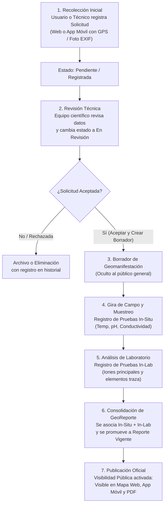

---

## 2. Gestión de Acceso y Roles de Usuario

### 2.1 Roles del Sistema y Matriz de Permisos

GeoterRA implementa un sistema de **Control de Acceso Basado en Roles (RBAC)** con **cinco perfiles oficiales**. Un visitante sin cuenta puede consultar el mapa público y descargar fichas técnicas, mientras que las operaciones de registro, campo, laboratorio y administración requieren autenticación.

| Capacidad / Módulo | Visitante (Sin Sesión) | Usuario General (`user`) | Investigador de Campo (`field_investigator`) | Investigador Principal (`investigator`) | Administrador Global (`admin`) | Mantenimiento (`maintenance`) |
| :--- | :---: | :---: | :---: | :---: | :---: | :---: |
| **Consultar Mapa Público y Filtros SNIT** | Sí | Sí | Sí | Sí | Sí | Sí |
| **Ver Ficha Técnica (Lindal / Piper) y Exportar PDF** | Sí | Sí | Sí | Sí | Sí | Sí |
| **Crear y Ver sus Propias Solicitudes** | No | Sí | Sí | Sí | Sí | No |
| **Editar / Eliminar Solicitudes Propias** | No | Sí | Sí | Sí | Sí | No |
| **Revisar Todas las Solicitudes y Cambiar Estados** | No | No | Sí | Sí | Sí | No |
| **Aprobar Solicitudes / Editar Química y Coordenadas** | No | No | Parcial (Estados) | Sí | Sí | No |
| **Eliminar Solicitudes de Terceros** | No | No | No | No | Sí | No |
| **Gestionar Geomanifestaciones y GeoReportes** | No | No | Sí | Sí | Sí | No |
| **Registrar y Editar Pruebas In-Situ (Campo)** | No | No | Sí | Sí | Sí | No |
| **Registrar y Editar Pruebas In-Lab (Laboratorio)** | No | No | No | Sí | Sí | No |
| **Consultar Giras de Campo (y Modo Gira Móvil)** | No | No | Sí | Sí | Sí | Sí |
| **Crear / Editar Giras y Asignar Participantes** | No | No | No | Sí | Sí | No |
| **Administrar Territorio SNIT (Provincias/Cantones/Distritos)** | No | No | No | No | Sí | No |
| **Gestionar Usuarios y Cambiar Roles** | No | No | No | No | Parcial (Ver/Gestionar) | Sí (Incluye Asignar Roles) |
| **Ver Dashboard de Infraestructura, Tablas BD y Logs** | No | No | No | No | No | Sí |

> **Nota sobre Identificadores Técnicos (ULID):** Por diseño institucional, los códigos internos de base de datos únicamente se muestran al rol **Mantenimiento (`maintenance`)** para tareas de auditoría; los demás roles trabajan con nombres legibles, códigos SNIT y códigos de solicitud (`SOLI-XXXXX`).

---

### 2.2 Registro de Nueva Cuenta

Cualquier persona interesada en reportar manifestaciones geotérmicas puede crear una cuenta de **Usuario General (`user`)** de forma autónoma:

1. En la barra superior del sitio web, haga clic en **Iniciar Sesión** (botón naranja) y luego seleccione el enlace **Registrarse**, o ingrese directamente a `/Register`.
2. Complete su **Nombre(s)** y **Apellido(s)** (solo se permiten letras, espacios, guiones y apóstrofes).
3. Ingrese un **Correo electrónico** válido y único.
4. Ingrese su **Número de teléfono** seleccionando el prefijo de país (por defecto Costa Rica `+506`).
5. Defina una **Contraseña segura** y confírmela. La contraseña debe cumplir con las políticas del sistema:
   - Entre **8 y 64 caracteres**.
   - Al menos **una letra minúscula** y **una letra mayúscula**.
   - Al menos **un número**.
   - Al menos **un carácter especial** (por ejemplo: `@`, `#`, `$`, `!`, `*`, `_`).
   - No debe contener su dirección de correo electrónico.
6. Haga clic en **Registrarse**. Al aparecer el mensaje de confirmación, seleccione **Ir a Iniciar Sesión**.

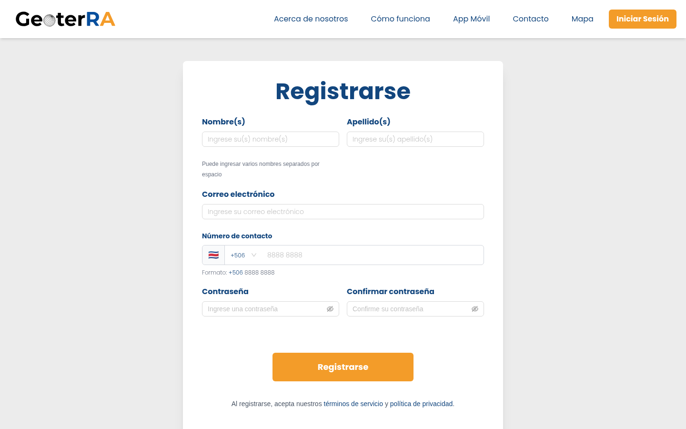

> **Importante:** Si requiere permisos de *Investigador de Campo*, *Investigador Principal* o *Administrador*, cree primero su cuenta estándar y solicite al equipo de **Mantenimiento** o **Administración** la actualización de su rol desde el panel de gestión de usuarios.

---

### 2.3 Inicio de Sesión y Recuperación de Contraseña

#### Cómo Iniciar Sesión

1. Haga clic en **Iniciar Sesión** en el encabezado superior (`/Login`).
2. Introduzca su **Correo** electrónico registrado y su **Contraseña** (puede usar el ícono del ojo para verificar los caracteres escritos).
3. Presione el botón **Iniciar Sesión**. El sistema validará sus credenciales y le redirigirá automáticamente a su **Dashboard** personalizado según su rol.

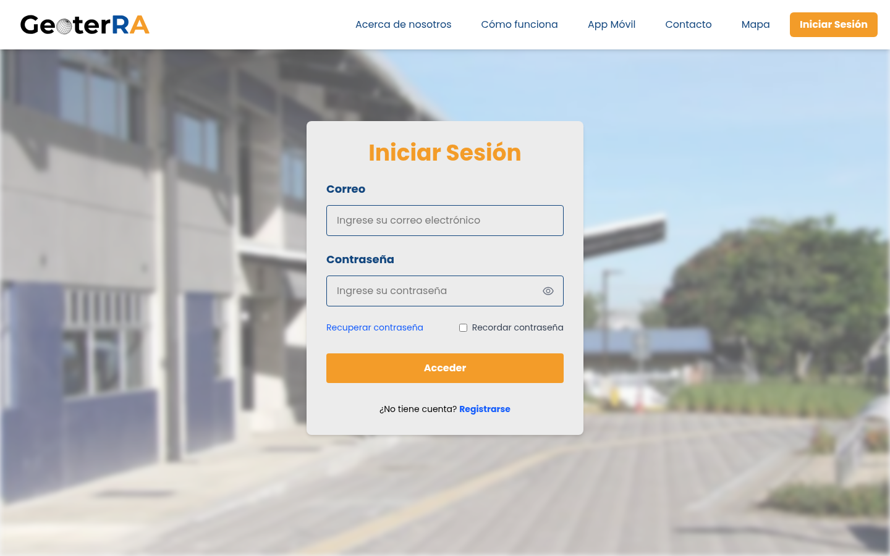

#### Cómo Recuperar una Contraseña Olvidada (Código OTP)

1. En la pantalla de **Iniciar Sesión**, haga clic en **¿Olvidaste tu contraseña?** (o **Recuperar**).
2. **Paso 1 — Solicitar código:** Escriba el correo electrónico asociado a su cuenta y presione **Enviar Código**. Recibirá un correo con un **código OTP numérico de 6 dígitos**.
3. **Paso 2 — Restablecer contraseña:** Ingrese el código de 6 dígitos antes de que expire el temporizador de **5 minutos (05:00)**, escriba y confirme su nueva contraseña y presione **Restablecer**.
4. **Paso 3 — Confirmación:** Una vez actualizado el acceso, regrese al formulario e inicie sesión con su nueva contraseña.

---

## 3. Guía Paso a Paso — Plataforma Web

### 3.1 Página de Inicio y Descarga Móvil

Al ingresar al portal principal (`/`), encontrará la barra de navegación fija superior con acceso directo a: **Acerca de nosotros**, **Cómo funciona**, **App Móvil**, **Contacto**, **Mapa** e **Iniciar Sesión** (o **Mi Perfil** si ya inició sesión).

1. En la sección de bienvenida, haga clic en **Ver mapa** para ir directamente al visor geoespacial sin necesidad de registrarse.
2. Desplácese hacia abajo o haga clic en **App Móvil** para acceder a la sección de descarga de la aplicación Android.

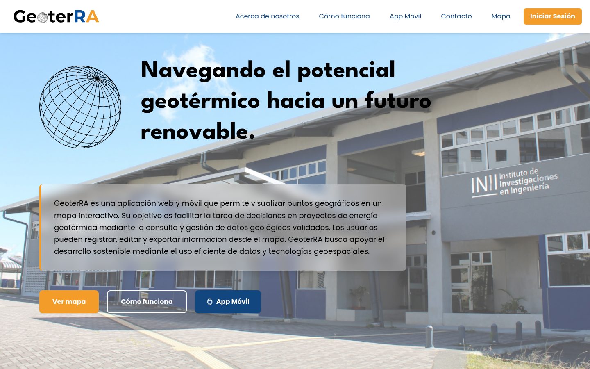

#### Descarga de la App Android desde el Portal Web

1. Ubíquese en la sección **GeoterRA Móvil** (`#mobile-app`).
2. Puede descargar el paquete `geoterraApp.apk` de dos maneras:
   - Haciendo clic en el botón naranja **Descargar GeoterRA APK** desde el navegador del teléfono o computadora.
   - Escaneando el **código QR** en pantalla con la cámara de su teléfono Android o Google Lens.

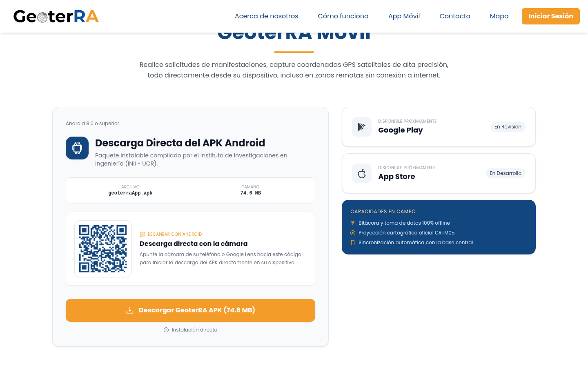

---

### 3.2 Mapa Interactivo de Geomanifestaciones (`/Map`)

El módulo **Mapa** es el núcleo de consulta pública de GeoterRA. Permite visualizar todas las geomanifestaciones validadas y publicadas sobre cartografía de OpenStreetMap y capas oficiales del IGN/SNIT.

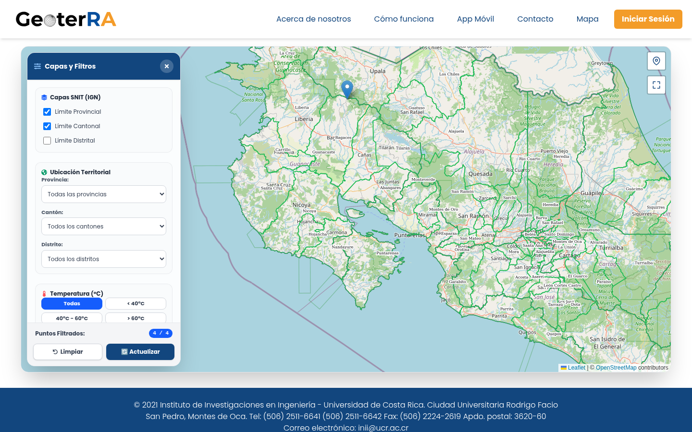

#### Cómo Usar el Panel de Capas y Filtros

El panel lateral izquierdo (**Capas y Filtros**) se encuentra abierto por defecto en pantallas de escritorio; si está contraído, haga clic en el botón flotante **Filtros y Capas** en la esquina superior izquierda.

1. **Activar o desactivar capas SNIT (IGN):**
   - Marque o desmarque **Límite Provincial**, **Límite Cantonal** y **Límite Distrital** para superponer las divisiones administrativas oficiales de Costa Rica.
2. **Filtrar por Ubicación Territorial (en cascada):**
   - Seleccione una **Provincia** en el menú desplegable.
   - Automáticamente se habilitará el selector de **Cantón** con los cantones pertenecientes a esa provincia, y al elegir uno, se habilitará el selector de **Distrito**.
3. **Filtrar por Temperatura (°C):**
   - Utilice los botones rápidos: **Todas**, **< 40°C**, **40°C - 60°C** o **> 60°C**.
   - O bien ingrese un rango numérico exacto en los campos **Mín (°C)** y **Máx (°C)**.
4. **Restablecer o actualizar:**
   - En la parte inferior del panel verá el contador **Puntos Filtrados** (`X / Total`).
   - Presione **Limpiar** para borrar todos los filtros activos, o **Actualizar** para recargar los puntos desde el servidor.

#### Herramientas Espaciales del Mapa

En la esquina superior derecha del visor encontrará dos botones de control:

- **Ir a mi ubicación (ícono de pin):** Solicita permiso de geolocalización al navegador, centra el mapa en su posición actual y coloca un marcador azul indicador.
- **Pantalla completa (ícono de expandir):** Amplía el mapa a toda la pantalla; presione nuevamente o la tecla `Esc` para salir.

#### Consultar Resumen Rápido de una Geomanifestación (Popup)

1. Haga clic sobre cualquier marcador azul en el mapa.
2. Se abrirá una ventana emergente con:
   - **Nombre de la manifestación** y **Ubicación territorial** (Provincia, Cantón, Distrito) más coordenadas **Lat / Lon**.
   - **Temp. In-Situ** en grados Celsius, junto con el **pH** y la **conductividad eléctrica (µS)** medidos en campo.
   - **Clasificación de Usos (Diagrama de Lindal):** Indicador visual del rango de aprovechamiento geotérmico según la temperatura registrada (por ejemplo: *Balnearios/Turismo*, *Acuicultura*, *Agricultura/Invernaderos*, *Calefacción espacial*, *Secado de madera*, *Procesos industriales* o *Generación eléctrica*).
3. Haga clic en el botón **Ver Detalles Completos y Diagramas** para abrir la ficha técnica completa.

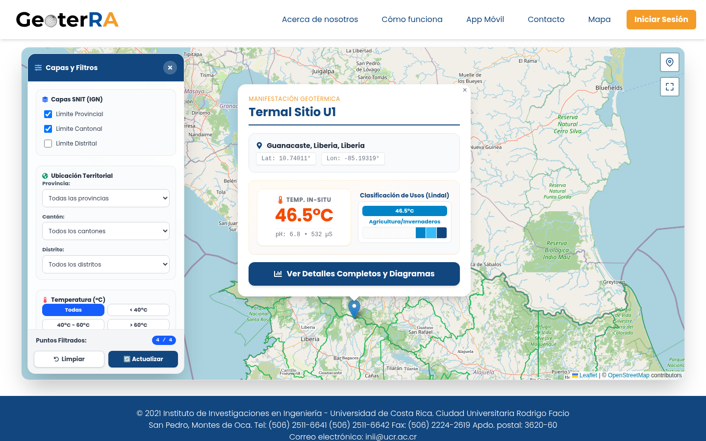

---

### 3.3 Ficha Técnica Completa y Exportación PDF (`/point-details/:id`)

La pantalla de detalles consolida toda la información oficial de una geomanifestación en cuatro bloques:

1. **Encabezado e Identificación:** Nombre del punto, ubicación administrativa, código identificador y botón **Imprimir / Exportar PDF** en la esquina superior derecha.
2. **Información General y Ubicación:** Provincia, cantón, distrito, coordenadas geográficas **WGS84** (`Lat` / `Lng`) y fecha de registro.
3. **Medidas de Campo e In-Situ:** Temperatura (°C), pH de campo, conductividad (µS/cm) y el **Diagrama de Lindal** completo. *(Si no existe temperatura válida mayor a 0°C, se muestra un aviso informativo y se oculta el diagrama para evitar interpretaciones erróneas).*
4. **Análisis Fisicoquímico de Laboratorio y Diagrama de Piper:**
   - Parámetros básicos de laboratorio (**pH Laboratorio** y **Conductividad Laboratorio**).
   - Tabla de **Iones Principales (mg/L):** `Cl⁻`, `Ca²⁺`, `HCO₃⁻`, `SO₄²⁻`, `Na⁺`, `K⁺`, `Mg²⁺` y `Si`.
   - Tabla de **Elementos Traza (mg/L):** `Fe`, `B`, `Li` y `F⁻`.
   - **Diagrama de Piper:** Gráfico ternario de cationes, aniones y rombo central para clasificar las facies hidrogeoquímicas del agua geotermal. *(En fumarolas secas o puntos sin análisis químico, el diagrama se omite automáticamente).*

#### Cómo Exportar la Ficha Técnica en PDF

1. Dentro de la ficha técnica del punto, haga clic en **Imprimir / Exportar PDF**.
2. En el cuadro de diálogo de su navegador, seleccione **Guardar como PDF** como destino, active la opción de gráficos de fondo si lo desea y presione **Guardar**. El documento incluye automáticamente el encabezado institucional de la UCR / INII y formato optimizado para impresión.

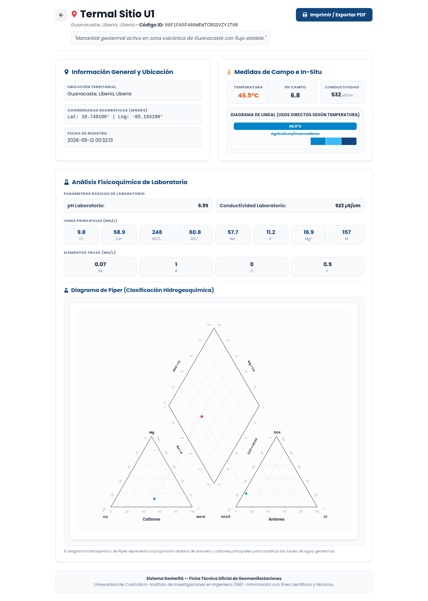

---

### 3.4 Panel de Control (Dashboard) según Rol

Al iniciar sesión e ingresar a `/Dashboard`, el sistema presenta una barra lateral de navegación a la izquierda (en dispositivos móviles se adapta a una barra inferior) y un panel de bienvenida adaptado a su rol:

- **Usuario General (`user`):** Muestra sus datos de identidad institucional y accesos rápidos a *Mis Solicitudes*, *Nueva Solicitud* y *Perfil*.
- **Investigador de Campo (`field_investigator`):** Muestra el indicador *Modo Terreno Habilitado* y accesos directos a *Giras Asignadas*, *Puntos Rápidos* y *Borradores en Estudio*.
- **Investigador Principal (`investigator`):** Presenta los espacios de trabajo científico para *Geomanifestaciones y Ensayos*, *Campañas y Giras de Terreno* y *División y Mapas SNIT*.
- **Administrador Global (`admin`):** Despliega métricas globales en tiempo real (*Solicitudes Recibidas*, *Pendientes de Revisión*, *Dictaminadas / Aprobadas*) y accesos directos a todos los módulos administrativos.
- **Mantenimiento (`maintenance`):** Muestra el estado de salud del servidor (*Estado del Servidor: Online*, *Usuarios Activos*, *Solicitudes Pendientes*, *Carga del Sistema*) y accesos a auditoría de base de datos, usuarios y logs.

| Panel de Usuario General | Panel de Investigador de Campo |
| :---: | :---: |
| 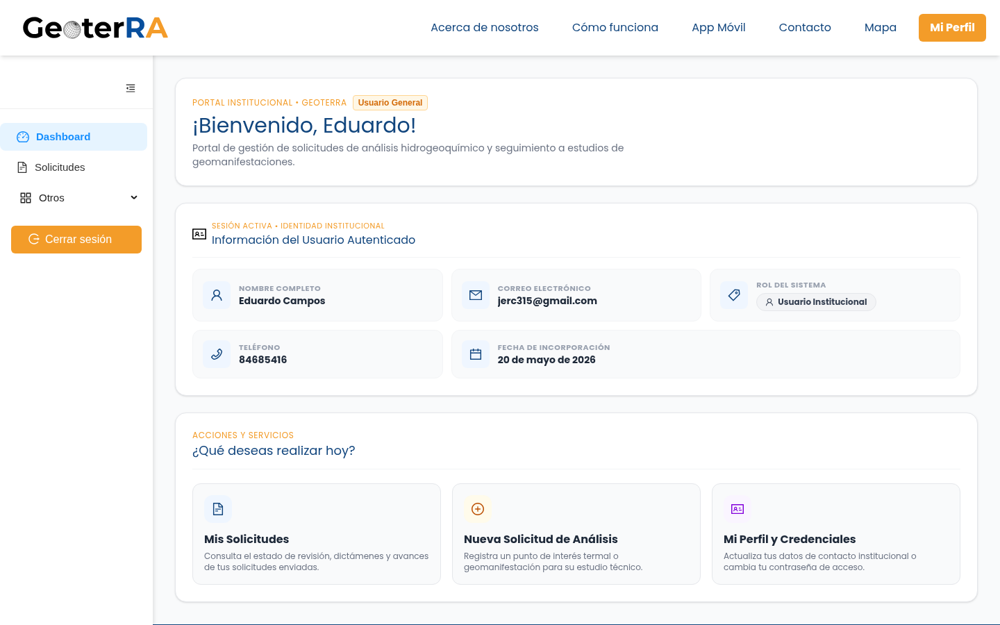 | 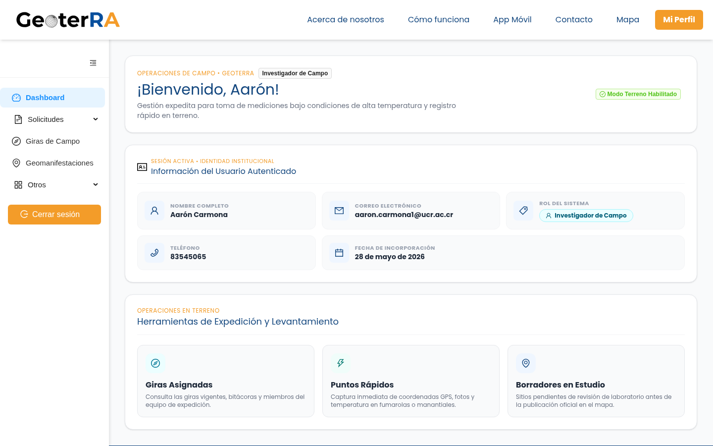 |

| Panel de Investigador Principal | Panel de Administrador Global |
| :---: | :---: |
| 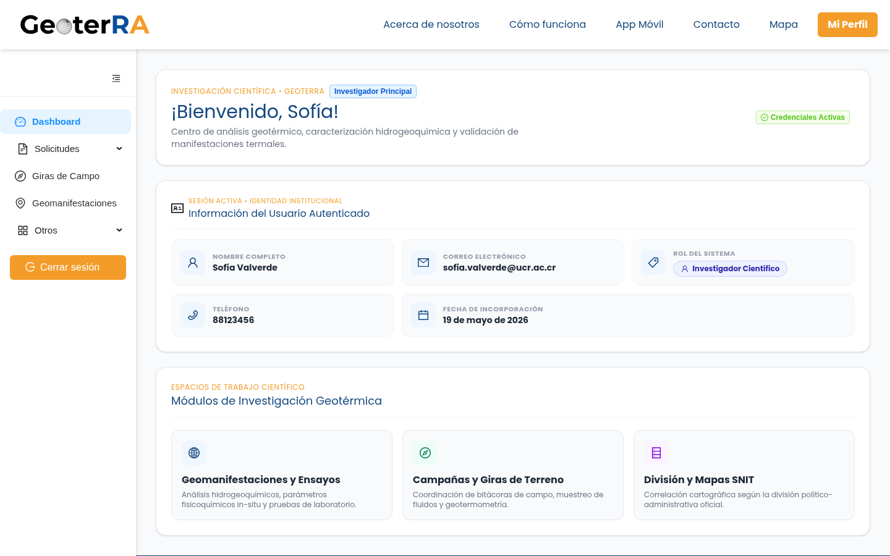 | 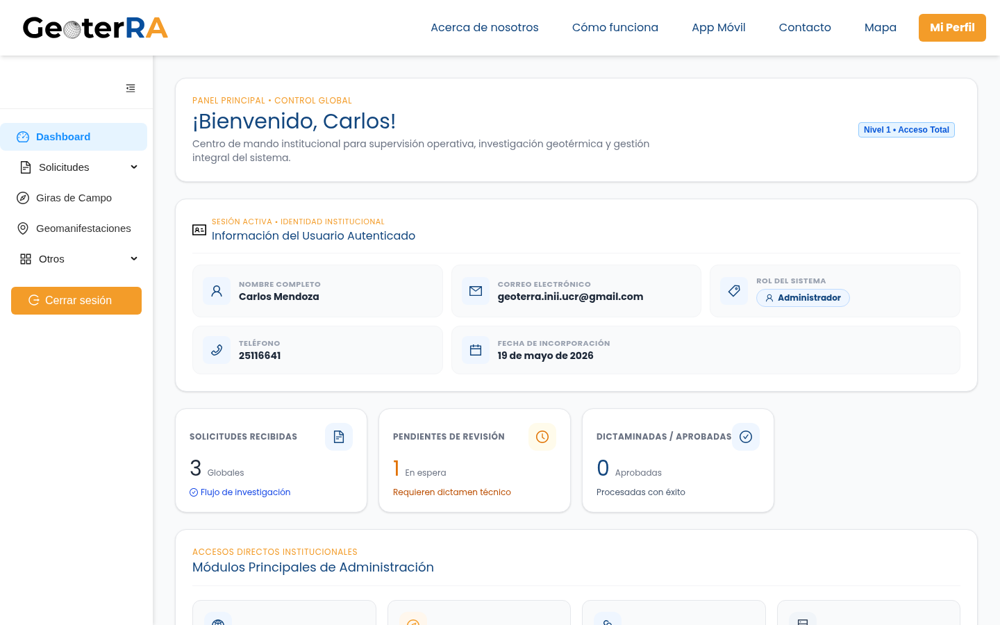 |

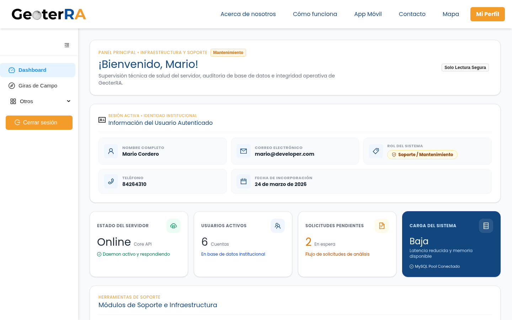

---

### 3.5 Mis Solicitudes y Registro de Nueva Solicitud

Este módulo está disponible en el menú lateral bajo **Solicitudes** (o **Solicitudes → Mis Solicitudes** para roles con permisos ampliados).

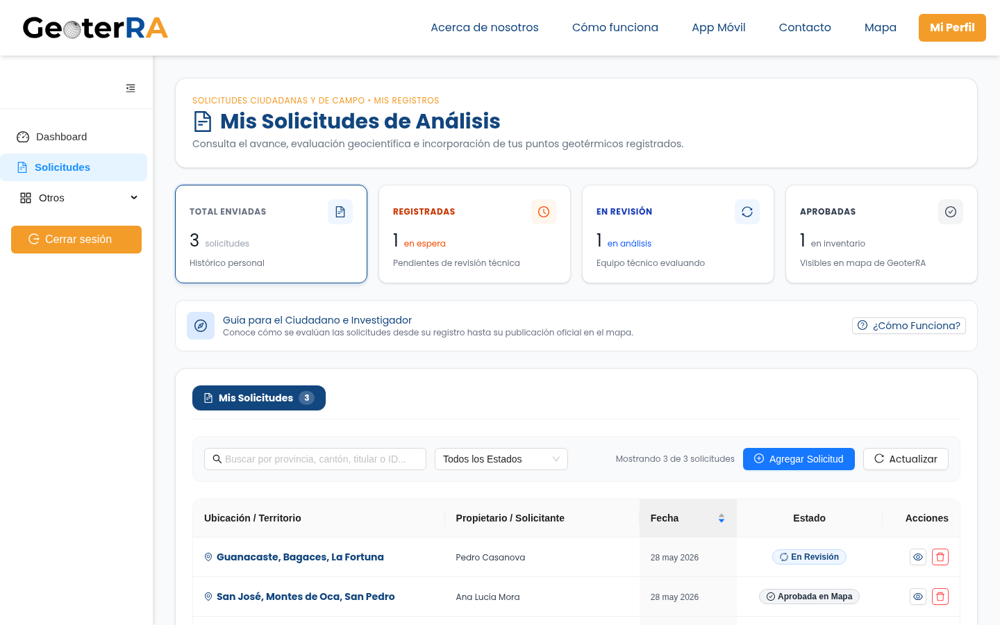

#### Cómo Crear una Nueva Solicitud de Análisis

1. Ingrese a **Mis Solicitudes** y haga clic en el botón **Agregar Solicitud**.
2. Se abrirá el **Formulario de Solicitud de Manifestación** (el formulario guarda un borrador temporal en su navegador mientras edita las coordenadas para evitar pérdidas accidentales).
3. **Ubicación Territorial:** Seleccione **Provincia**, **Cantón** y **Distrito** en cascada.
4. **Características del Sitio:**
   - Elija el **Uso actual** del terreno (`Residencial`, `Comercial`, `Turístico`, `Conservación`, `Ganadería` u `Otro`).
   - Deslice el control de **Sensación térmica** (`Natural`, `Templado`, `Caliente`, `Muy Caliente`, `Hirviendo`) o active la casilla **Sin Especificar** si no pudo percibir la temperatura.
   - Indique si se observan **Burbujas** en el agua o lodo.
5. **Información del Propietario (Opcional):** Si usted conoce al propietario del terreno y desea incluir sus datos, active la opción correspondiente e ingrese nombre, teléfono, correo y relación (`Titular`, `Familiar`, `Empleado`, `Socio`, `Conocido`).
6. **Ubicación Exacta en el Mapa:** Haga clic sobre el mapa integrado para fijar la **Latitud** y **Longitud** exactas, o escriba una referencia en **Dirección exacta** y observaciones en **Detalles adicionales**.
7. Presione **Enviar** (o **Confirmar**). Al completarse, la solicitud aparecerá en su listado con estado inicial **Registrada** / **Pendiente**.

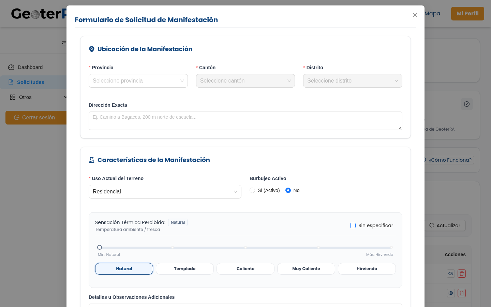

#### Consultar, Editar o Eliminar una Solicitud Propia

1. Haga clic sobre el nombre/ubicación de cualquier solicitud en la tabla (o en el ícono del ojo **Ver Detalles**).
2. En el modal de detalles podrá visualizar la ubicación en el mapa y la **línea de tiempo del historial de estados** (fecha, estado y observación administrativa).
3. Haga clic en **Editar** para corregir coordenadas, detalles o datos de contacto, o en el ícono de **Eliminar** para borrar la solicitud previa confirmación.

---

### 3.6 Gestión y Verificación Científica de Solicitudes (Equipo Técnico y Admin)

Disponible en **Solicitudes → Gestionar Solicitudes** para los roles `admin`, `investigator` y `field_investigator`.

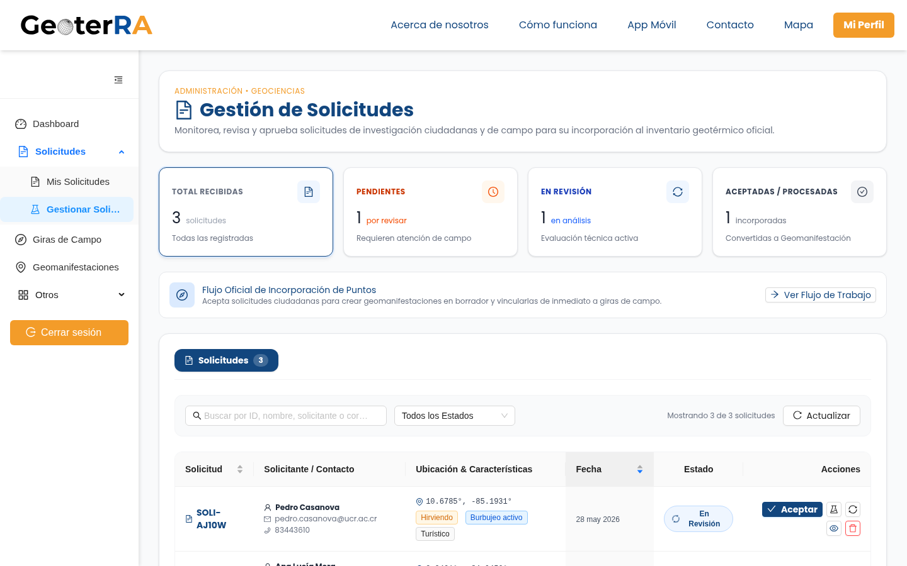

#### Cómo Revisar y Dictaminar Solicitudes

1. Utilice los **KPIs superiores** (*Totales*, *Pendientes*, *En Revisión*, *Procesadas*) o la barra de búsqueda para filtrar las solicitudes recibidas.
2. **Cambiar Estado:** Haga clic en el botón de cambio de estado para mover una solicitud a `Pendiente`, `En Revisión`, `Procesada` o `Rechazada`, añadiendo una descripción técnica que quedará registrada en el historial del solicitante.
3. **Aceptar y Convertir en Borrador de Geomanifestación:**
   - Haga clic en la acción de aceptar solicitud y confirme en el diálogo **¿Aceptar Solicitud y Crear Geomanifestación?**.
   - El sistema creará automáticamente una nueva geomanifestación en estado **Borrador (oculta)** con las coordenadas reportadas y cambiará la solicitud a `Procesada`.
4. **Aprobar con Datos Científicos Completos:** Si ya cuenta con parámetros In-Situ e In-Lab, utilice el formulario de aprobación para verificar coordenadas en el mapa e ingresar los valores fisicoquímicos iniciales.
5. **Eliminar (Solo `admin`):** Permite depurar solicitudes duplicadas o inválidas mediante confirmación explícita.

---

### 3.7 Geomanifestaciones, Pruebas y GeoReportes (`GeomanifeStationsManager`)

Disponible en el menú lateral **Geomanifestaciones** para `admin`, `investigator` y `field_investigator`. Centraliza el catálogo científico oficial mediante el esquema jerárquico estándar de GeoterRA.

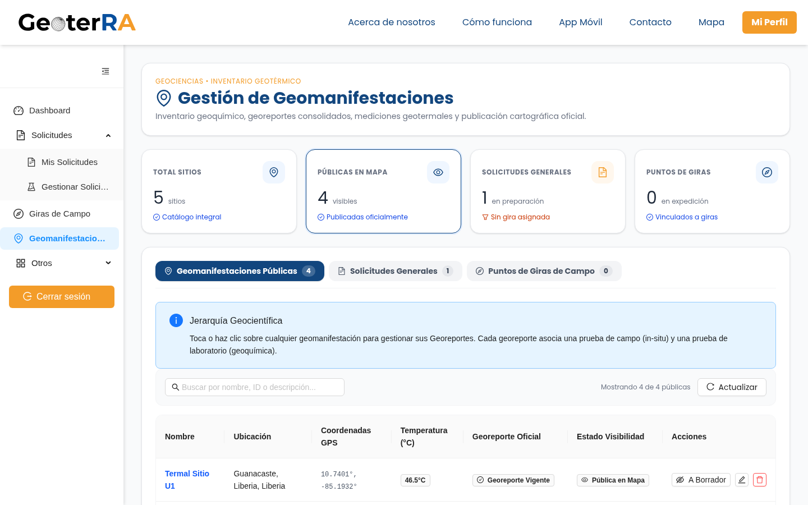

#### Pestañas y Creación de Puntos

1. En la parte superior de la tarjeta principal encontrará dos pestañas píldora:
   - **Publicadas en Mapa:** Geomanifestaciones con visibilidad pública activa (`visibility = 1`) visibles para todo público en `/Map`.
   - **Borradores / En Estudio:** Puntos recién creados, provenientes de solicitudes aceptadas o capturados en giras de campo (`visibility = 0`), ocultos del mapa público hasta completar su validación.
2. Para crear un punto manualmente, presione **Nuevo Registro** en el encabezado, complete el nombre, descripción, provincia/cantón/distrito, gira asociada (opcional), coordenadas en el mapa y presione **Guardar**.

#### Cómo Gestionar Estudios, Pruebas y GeoReportes de un Punto

1. Haga clic sobre cualquier fila de la tabla de geomanifestaciones para abrir el **Panel Lateral (Drawer) de Estudios, Pruebas y GeoReportes**.
2. Dentro del drawer encontrará cinco pestañas organizadas jerárquicamente:
   - **Georeportes:** Muestra el GeoReporte marcado como **Vigente Oficial en Mapa** (con insignia destacada) y el historial de reportes del punto.
     - Haga clic en **+ Asociar Georeporte** para combinar una Prueba In-Situ existente + una Prueba de Laboratorio existente y opcionalmente marcarlo como vigente.
     - Si hay varios reportes históricos, haga clic en el botón de estrella (**Promover a Vigente**) para definir cuál versión se publica en la ficha técnica oficial.
   - **Pruebas In-Situ:** Permite crear, editar o eliminar mediciones de campo (`Temperatura °C`, `Conductividad µS/cm`, `pH` y descripción).
   - **Pruebas de Laboratorio:** *(Disponible para `admin` e `investigator`; oculto para `field_investigator`)* Permite registrar o editar el análisis completo de laboratorio (`pH`, `Conductividad`, `Cl⁻`, `Ca²⁺`, `HCO₃⁻`, `SO₄²⁻`, `Na⁺`, `K⁺`, `Mg²⁺`, `Si`, `Fe`, `B`, `Li`, `F⁻`).
   - **Comentarios y Colaboración:** Bitácora colaborativa de notas internas del equipo investigador sobre el punto.
   - **Detalles Geográficos:** Resumen de ubicación SNIT y coordenadas exactas del punto.
3. **Publicar o Retirar del Mapa Público:** Desde las acciones de fila de la tabla principal, utilice el botón **Publicar en Mapa** (en Borradores) o **Mover a Borrador** (en Publicadas) para controlar la visibilidad inmediata en el visor público.

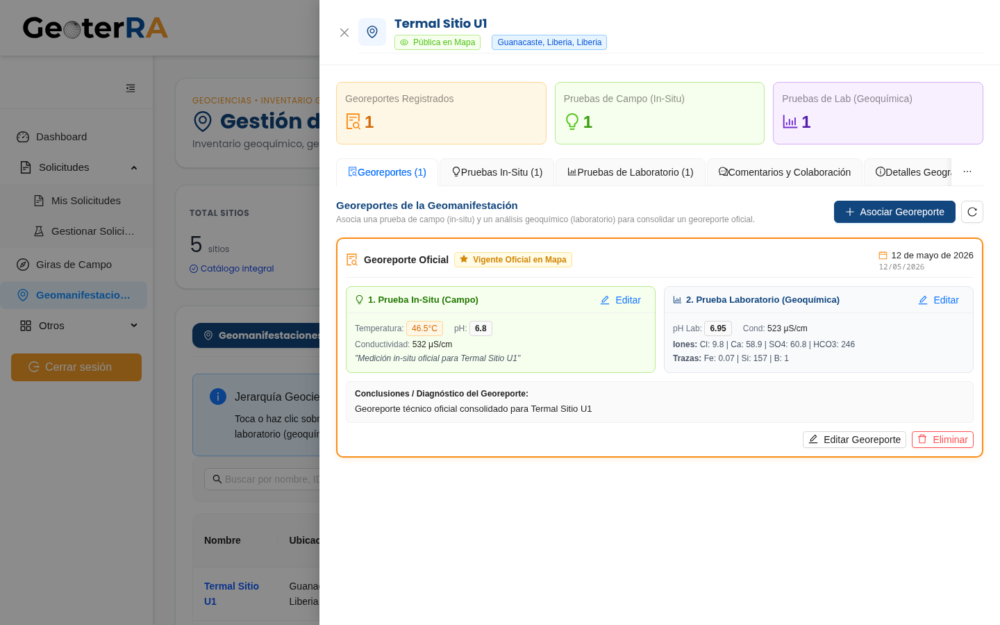

---

### 3.8 Giras de Campo y Punto Rápido (`FieldTripsManager`)

Disponible en **Giras de Campo** para `admin`, `investigator`, `field_investigator` y `maintenance`.

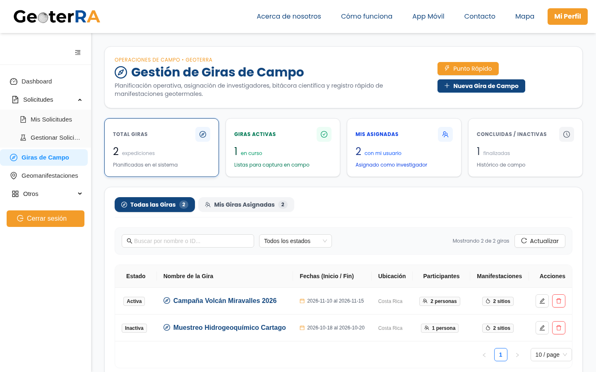

#### Cómo Gestionar Giras de Campo (`admin` e `investigator`)

1. Cambie entre las pestañas **Todas las Giras** y **Mis Giras Asignadas** usando las píldoras superiores, o filtre por estado (*Activa* / *Inactiva*).
2. Presione **Nueva Gira de Campo**, ingrese el nombre de la expedición, fechas de inicio y finalización, ubicación SNIT (Provincia/Cantón/Distrito), estado activo y guarde.
3. Haga clic en **Ver Detalle** sobre una gira para abrir su panel lateral, donde podrá:
   - **Agregar o remover participantes** del equipo investigador.
   - **Vincular o desvincular geomanifestaciones** visitadas durante la campaña.
   - Revisar y publicar comentarios operativos en la bitácora de la gira.

#### Cómo Usar "Punto Rápido en Campo" (`admin`, `investigator`, `field_investigator`)

Diseñado para registrar hallazgos directamente desde el terreno con mínimos pasos:

1. Dentro del módulo **Giras de Campo** (o en el detalle de una gira activa), haga clic en **Punto Rápido**.
2. Presione **Obtener Ubicación GPS** para capturar automáticamente las coordenadas de su dispositivo (con indicador de precisión en metros `±Xm`), o marque el punto manualmente en el mapa desplegable.
3. El sistema sugiere un nombre consecutivo automático vinculado a la gira (editable si lo desea).
4. Ingrese las mediciones **In-Situ** rápidas (**Temperatura °C**, **pH**, **Conductividad**) y notas de campo.
5. Presione **Guardar**. El punto quedará creado como **Borrador de Geomanifestación** vinculado a la gira junto con su prueba In-Situ asociada.

---

### 3.9 Administración Territorial SNIT (`TerritoryManager`)

Disponible en **Otros → Territorio** exclusivamente para el rol **`admin`**.

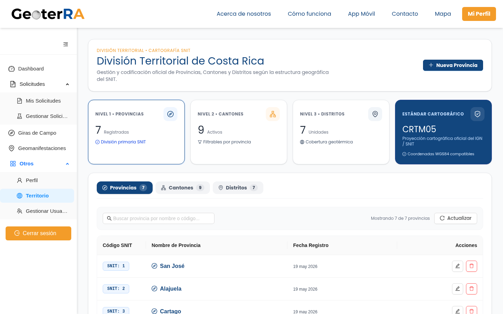

1. Use las pestañas píldora **Provincias**, **Cantones** y **Distritos** para navegar entre los tres niveles de la división político-administrativa de Costa Rica.
2. En **Cantones** y **Distritos**, utilice los selectores de filtro superior para acotar por provincia o cantón padre.
3. Haga clic en **Nuevo Registro** para agregar una nueva unidad territorial indicando su **Código SNIT** oficial y **Nombre**, o use los íconos de **Editar** y **Eliminar** en la columna de acciones.

---

### 3.10 Gestión de Usuarios y Roles (`UserManagement`)

Disponible en **Otros → Gestionar Usuarios** para los roles **`maintenance`** y **`admin`**.

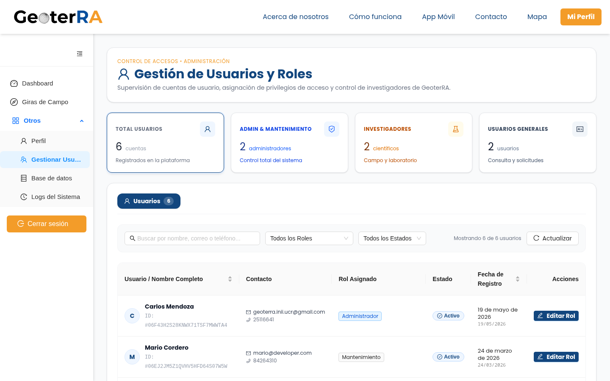

1. Revise los indicadores superiores (*Total de Usuarios*, *Administradores y Soporte*, *Investigadores*, *Usuarios Generales*).
2. Busque por nombre, correo o teléfono, o filtre por **Rol** y **Estado** (*Activo* / *Inactivo*).
3. Para cambiar el nivel de acceso de una persona, haga clic en **Editar Rol** en su fila, seleccione el nuevo rol (`Administrador`, `Mantenimiento`, `Investigador de Laboratorio`, `Investigador de Campo` o `Usuario General`) y confirme.

---

### 3.11 Auditoría Técnica: Base de Datos y Logs del Sistema

Exclusivo para el rol **`maintenance`** desde **Otros → Base de datos** y **Otros → Logs del Sistema**.

#### Explorador de Base de Datos (Solo Lectura)

1. Seleccione cualquiera de las tablas relacionales en las píldoras superiores (`Usuarios`, `Solicitudes de Investigación`, `Geomanifestaciones`, `Pruebas de Campo`, `Pruebas de Laboratorio`, `GeoReportes`, `Provincias`, `Cantones`, `Distritos`, entre otras).
2. Utilice la barra de búsqueda para filtrar filas por cualquier columna o identificador ULID. Este módulo opera estrictamente en modo **Solo Lectura** para proteger la integridad de los datos.

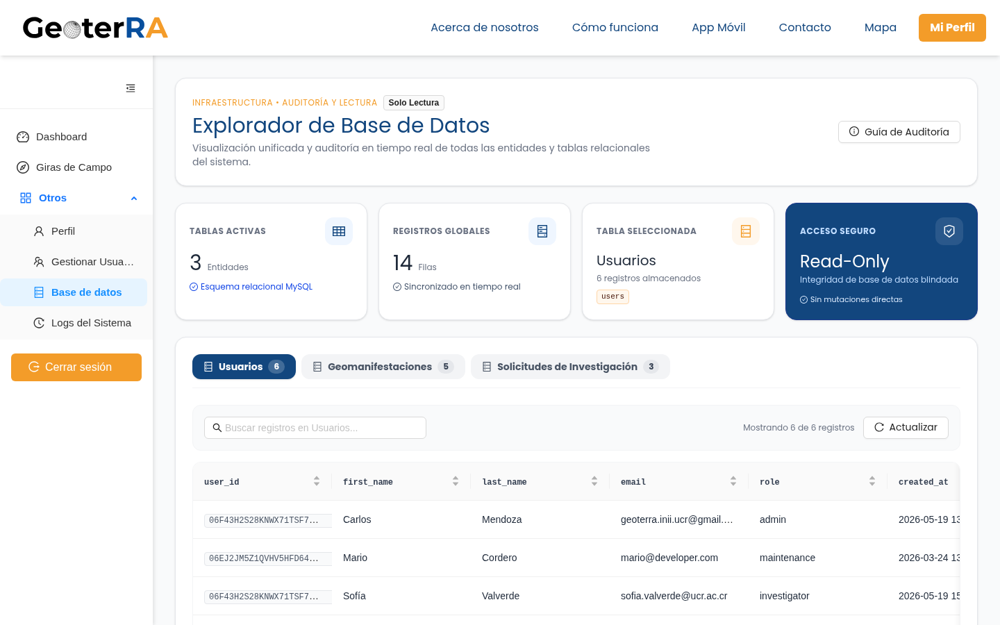

#### Logs del Sistema en Tiempo Real

1. Visualice las últimas 500 líneas de registro del servidor backend PHP.
2. Active o pause el interruptor **Auto-refresh** (actualización automática cada 5 segundos).
3. Filtre eventos haciendo clic en los KPIs superiores (**Buffer Total**, **Errores / Fallos**, **Advertencias**, **Peticiones HTTP**) o buscando texto específico.
4. Use **Copiar** para llevar los logs filtrados al portapapeles o **Exportar** para descargar un archivo `.log`.

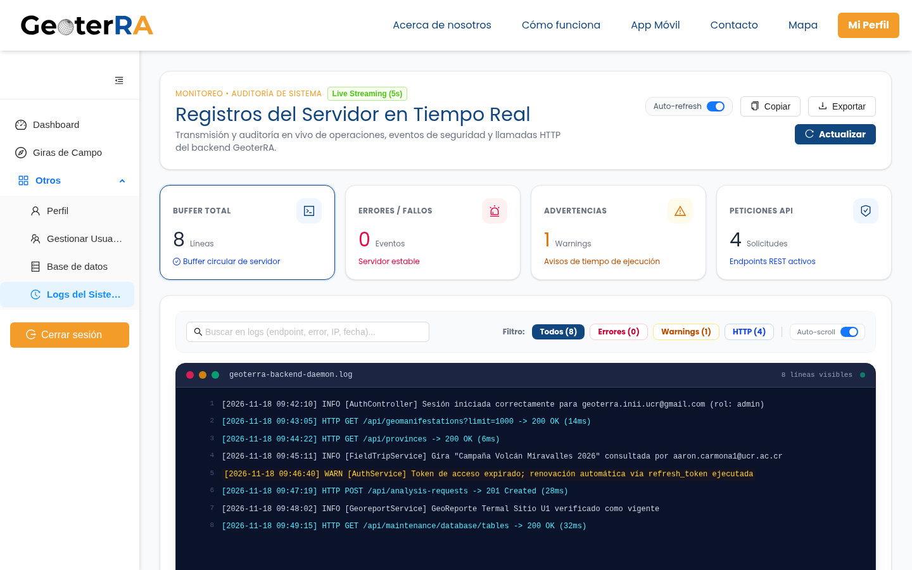

---

### 3.12 Perfil de Usuario y Seguridad (`ProfilePage`)

Accesible para todos los usuarios autenticados desde **Otros → Perfil**.

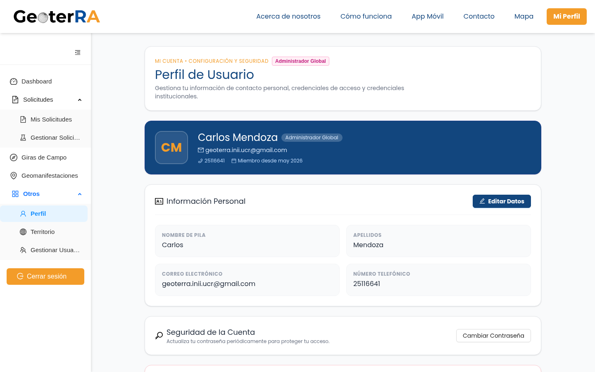

1. **Editar Información Personal:** Haga clic en **Editar Datos**, actualice su nombre, apellidos, correo o teléfono y confirme los cambios.
2. **Cambiar Contraseña:** Despliegue la sección de seguridad, ingrese su contraseña actual, defina y confirme la nueva contraseña (cumpliendo la política de complejidad) y guarde.
3. **Eliminar Cuenta:** En la parte inferior puede solicitar la desactivación lógica (*soft-delete*) de su cuenta previa confirmación.

---

## 4. Guía Paso a Paso — Aplicación Móvil

La aplicación móvil **GeoterRA** está diseñada para trabajar cómodamente desde teléfonos y tabletas Android e iOS, con soporte para **tema claro / oscuro**, captura GPS directa, lectura de coordenadas **EXIF** en fotografías, generación local de reportes **PDF** y un **Modo Gira de Campo** especializado para expediciones científicas.

### 4.1 Instalación y Permisos Requeridos

#### Instalación en Android (APK Directo)

1. Desde el navegador de su dispositivo Android, visite la sección **App Móvil** de la web de GeoterRA (o escanee el código QR).
2. Descargue el archivo `geoterraApp.apk`.
3. Al abrir el archivo descargado, si Android solicita autorización para *"Instalar aplicaciones desconocidas"* desde su navegador o gestor de archivos, active **Permitir desde esta fuente** y toque **Instalar**.
4. Abra **GeoterRA** desde su menú de aplicaciones.

#### Permisos del Sistema

Para aprovechar todas las funciones en campo, la aplicación solicitará los siguientes permisos cuando sean necesarios:

| Permiso | Finalidad en la App | Qué pasa si se rechaza |
| :--- | :--- | :--- |
| **Ubicación precisa (`GPS`)** | Mostrar su posición azul en el mapa y rellenar automáticamente Latitud/Longitud al crear solicitudes o geomanifestaciones. | Podrá navegar por el mapa manualmente, pero no podrá centrar en su ubicación ni autocompletar coordenadas GPS. |
| **Cámara y Galería** | Tomar fotografías del punto geotérmico o elegir imágenes existentes para extraer coordenadas **EXIF** automáticamente. | Deberá capturar su ubicación por GPS directo sin lectura de metadatos de foto. |
| **Almacenamiento / Archivos** | Guardar y abrir los reportes **PDF** generados localmente (en Android < 10 o compartir archivos en iOS). | No se podrá almacenar o abrir el archivo PDF descargado. |

---

### 4.2 Acceso, Registro y Recuperación de Contraseña

1. **Inicio de Sesión:** En la pantalla de acceso, ingrese su **Correo Electrónico** y **Contraseña** y toque **Ingresar**. Sus tokens de acceso y renovación permanecen guardados de forma segura en el dispositivo para evitar iniciar sesión cada vez que abra la app.
2. **Registro:** Toque **Regístrese aquí** si aún no tiene cuenta, complete sus datos personales, correo, teléfono (opcional) y contraseña, y toque **Registrarme**.
3. **Recuperación de Contraseña:** Toque **Recuperar** en la pantalla de acceso, ingrese su correo, presione **Enviar Código**, digite el código **OTP** de 6 dígitos recibido en su bandeja de entrada, establezca su nueva contraseña y toque **Restablecer Contraseña**.

> **[CAPTURA REQUERIDA]:** Abrir la app móvil GeoterRA sin sesión iniciada en la pantalla `SignInScreen` mostrando el logo superior, fondo fotográfico de rocas y los campos "Correo Electrónico", "Contraseña" y botón "Ingresar".

> **[CAPTURA REQUERIDA]:** Tocar "¿Ha olvidado su contraseña? Recuperar" en `SignInScreen` para mostrar `PasswordRecoveryScreen` en el paso 2 (campos de código OTP de 6 dígitos y "Nueva Contraseña").

---

### 4.3 Navegación Principal (Barra Inferior)

La aplicación móvil cuenta con una barra inferior fija de **4 pestañas principales**:

1. **Inicio (`HomeTab`):** Portada informativa con acceso rápido al mapa interactivo (*Ver mapa interactivo*), resumen del flujo de trabajo en 3 pasos, misión institucional e información de contacto de la UCR / INII.
2. **Mapa (`MapTab`):** Visor geoespacial interactivo basado en MapLibre con marcadores agrupados (*clusters*) y capas SNIT.
3. **Solicitudes (`RequestTab`) o Giras (`FieldTripTab`):**
   - Por defecto muestra **Solicitudes** para consultar y crear solicitudes de análisis.
   - Para personal autorizado (`field_investigator`, `investigator`, `admin`, `maintenance`), al activar el interruptor **Modo Gira de Campo** en la pestaña *Cuenta*, esta tercera pestaña cambia dinámicamente a **Giras** para operaciones científicas de expedición.
4. **Cuenta (`AccountTab`):** Perfil, rol asignado, cambio de tema Claro/Oscuro, interruptor de *Modo Gira de Campo*, edición de perfil, cambio de contraseña y cierre de sesión.

> **[CAPTURA REQUERIDA]:** Mostrar la pestaña `Inicio` (`HomeScreen`) tras iniciar sesión, dejando visible la imagen superior con el logo GeoterRA, el botón "Ver mapa interactivo" y la barra inferior de 4 pestañas.

---

### 4.4 Mapa Móvil, Capas SNIT, Filtros y Fichas Técnicas

> **[CAPTURA REQUERIDA]:** Abrir la pestaña `Mapa` (`MapScreen`) centrada sobre Costa Rica mostrando los marcadores de geomanifestaciones y/o agrupaciones (`Geomanifestaciones (N)`), además de los dos botones flotantes inferiores derechos (Ubicación y Filtros).

#### Cómo Filtrar Capas y Puntos en el Mapa Móvil

1. Toque el **botón flotante de Filtros** (esquina inferior derecha del mapa).
2. Se abrirá el panel inferior **Configuración de Mapa**:
   - **Capas:** Seleccione o deseleccione las capas cartográficas y ráster SNIT disponibles.
   - **Filtros Geográficos:** Elija **Provincia**, **Cantón** y **Distrito** mediante los selectores buscables en cascada.
   - **Rango de Temperatura (°C):** Ingrese valores en **Mínima** y **Máxima**.
3. Toque **Aplicar Filtros** para actualizar los marcadores visibles o **Limpiar** para restablecer la vista completa.
4. Para centrar el mapa en su posición actual, toque el **botón flotante de Mi Ubicación**.

> **[CAPTURA REQUERIDA]:** Abrir `FilterBottomModal` en `MapScreen` mostrando la sección "Configuración de Mapa", tarjetas de selección de Capas, desplegables de Provincia/Cantón/Distrito y campos de Temperatura Mínima/Máxima.

#### Consultar un Punto y Descargar su Ficha PDF

1. Toque cualquier marcador individual en el mapa (si toca un clúster agrupado, el mapa hará zoom automático para separar los puntos).
2. Aparecerá la tarjeta inferior **`ManifestationInfoPanel`** con el nombre, ubicación territorial, coordenadas y valores de **Temperatura**, **pH** y **Conductividad**.
3. Toque **Explorar Detalles Técnicos** para abrir la pantalla completa **`GeomanifestationScreen`**, donde podrá revisar:
   - Información general y detalles del reporte vigente.
   - Análisis de campo (*In-Situ*).
   - Análisis de laboratorio (*In-Lab*), iones principales y elementos traza agrupados por tarjetas.
4. Toque el botón flotante **Descargar PDF** para generar localmente el informe en PDF y abrirlo o compartirlo con otras aplicaciones de su dispositivo.

| Panel Resumido de Punto en Mapa | Ficha Completa de Geomanifestación |
| :---: | :---: |
|  |  |

> **[CAPTURA REQUERIDA] (`mobile_mapa_panel_punto.png`):** Tocar un marcador en `MapScreen` para mostrar `ManifestationInfoPanel` en la parte inferior con Temperatura, pH, Conductividad y el botón "Explorar Detalles Técnicos".  
> **[CAPTURA REQUERIDA] (`mobile_geomanifestacion_detalle.png`):** Ingresar a `GeomanifestationScreen` desde ese botón mostrando las secciones "Información General", "Análisis de Campo" y "Parámetros Físicos", junto con el botón flotante "Descargar PDF".

---

### 4.5 Captura de Datos en Campo — Solicitudes de Análisis

1. Ingrese a la pestaña **Solicitudes** (`InvestigationRequestsScreen`). Verá el listado de sus solicitudes con su código (`SOLI-XXXXX`), ubicación y distintivo de estado.
2. Toque el botón flotante de nueva solicitud (**+** / Crear) para abrir el formulario **`InvestigationRequestFormScreen`**.
3. Complete las secciones paso a paso:
   - **Ubicación Geográfica:** Seleccione **Provincia**, **Cantón** y **Distrito**.
   - **Información del Sitio:** Seleccione el **Uso actual** del sitio.
   - **Relación con el Propietario:** Si elige un valor distinto de `Titular` (`Familiar`, `Empleado`, `Socio`, `Conocido`), complete los campos adicionales del propietario.
   - **Observaciones Físicas:** Seleccione la **Sensación térmica**, active el interruptor **Presencia de burbujas** si aplica, y agregue **Detalles adicionales**.
   - **Ubicación Exacta y Evidencia:** Ingrese la **Dirección exacta** y obtenga las coordenadas mediante:
     - El botón **Obtener Ubicación GPS** (captura directa desde el sensor del teléfono), o
     - El selector de **Cámara / Galería**, que además intenta leer automáticamente las coordenadas GPS incrustadas en los **metadatos EXIF** de la fotografía.
4. Toque **Enviar Solicitud**.
5. Al volver a la lista, puede tocar cualquier tarjeta para abrir **`InvestigationRequestDetailsScreen`**, editarla, eliminarla o presionar **Descargar PDF** para guardar el comprobante técnico de la solicitud.

| Listado de Solicitudes | Formulario de Nueva Solicitud | Detalle de Solicitud y PDF |
| :---: | :---: | :---: |
|  |  |  |

> **[CAPTURA REQUERIDA] (`mobile_solicitudes_lista.png`):** Pestaña `Solicitudes` con sesión iniciada mostrando al menos 2 tarjetas `RequestCardItem` con su badge de estado y botones de acción.  
> **[CAPTURA REQUERIDA] (`mobile_nueva_solicitud.png`):** Pantalla `InvestigationRequestFormScreen` mostrando las secciones de Provincia/Cantón/Distrito, Sensación térmica, switch de Burbujas y botón "Obtener Ubicación GPS".  
> **[CAPTURA REQUERIDA] (`mobile_solicitud_detalle.png`):** Pantalla `InvestigationRequestDetailsScreen` mostrando el detalle completo, historial de estados y botón flotante "Descargar PDF".

---

### 4.6 Modo Gira de Campo, Geomanifestaciones y Pruebas In-Situ (Personal Autorizado)

Esta funcionalidad está disponible únicamente para cuentas con rol **`field_investigator`**, **`investigator`**, **`admin`** o **`maintenance`**.

#### Cómo Activar el Modo Gira de Campo

1. Vaya a la pestaña **Cuenta** (`AccountScreen`).
2. En la sección **Configuración**, active el interruptor **Modo Gira de Campo**.
3. Observará que la tercera pestaña de la barra inferior cambia de **Solicitudes** a **Giras**.

#### Flujo de Trabajo en una Gira de Campo

1. Abra la pestaña **Giras** (`FieldTripScreen`) y alterne entre **Generales** y **Asignadas** para localizar su expedición activa.
2. Toque una gira para abrir **`FieldTripDetailsScreen`**, donde podrá consultar fechas de inicio/fin, ubicación SNIT, organizador, lista de participantes y manifestaciones geotérmicas vinculadas (además de exportar el resumen de la gira en **PDF**).
3. **Registrar una Nueva Geomanifestación en Campo (`GeomanifestationFormScreen`):**
   - Desde el detalle de la gira, agregue una nueva geomanifestación indicando nombre, descripción, visibilidad pública (`Visible públicamente` u `Oculto / Privado`), provincia/cantón/distrito y presionando **Obtener Ubicación GPS**.
   - Toque **Guardar Geomanifestación**.
4. **Registrar una Prueba In-Situ (`InSituFormScreen`):**
   - Entre al detalle de la geomanifestación recién creada o existente (`GeomanifestationDetailsScreen`) y agregue una prueba de campo.
   - Ingrese el **Nombre de la prueba**, **Descripción y Notas**, **Temperatura (°C)**, **pH** y **Conductividad (µS/cm)**.
   - Toque **Guardar Prueba de Campo** para enviarla al sistema.

| Modo Gira en Cuenta | Lista y Detalle de Giras | Formulario Prueba In-Situ |
| :---: | :---: | :---: |
|  |  |  |

> **[CAPTURA REQUERIDA] (`mobile_modo_gira.png`):** Pestaña `Cuenta` (`AccountScreen`) con un usuario investigador/admin donde se vea el toggle **Modo Gira de Campo** activado y la tercera pestaña inferior cambiada a **Giras**.  
> **[CAPTURA REQUERIDA] (`mobile_gira_detalle.png`):** Pantalla `FieldTripDetailsScreen` mostrando fechas, ubicación, participantes y tarjetas de manifestaciones geotérmicas asociadas.  
> **[CAPTURA REQUERIDA] (`mobile_insitu_form.png`):** Pantalla `InSituFormScreen` mostrando los campos "Nombre de la prueba", "Temperatura (°C)", "pH", "Conductividad (µS/cm)" y botón "Guardar Prueba de Campo".

---

### 4.7 Operación en Campo, Conectividad y Sincronización

Comprender cómo gestiona la App Móvil los datos locales y la conexión con el servidor es fundamental durante expediciones en zonas volcánicas remotas:

- **Persistencia Local Automática:** La aplicación conserva localmente en el dispositivo sus credenciales de sesión (*tokens* de acceso y renovación), la preferencia de tema (**Modo Oscuro / Claro**), el estado del **Modo Gira de Campo** y todos los **reportes PDF** generados, por lo que estos archivos pueden consultarse y compartirse sin conexión.
- **Sincronización en Línea con la API Central:** El envío de nuevas solicitudes, el registro de geomanifestaciones en gira, las pruebas *In-Situ* y la descarga de marcadores actualizados del mapa se comunican directamente con el servidor central de GeoterRA al presionar **Enviar** o **Guardar**.
- **Recomendación en Zonas sin Cobertura Celular:**
  1. Mantenga el **GPS del dispositivo activo** (el sensor satelital GPS funciona sin internet).
  2. Tome fotografías del sitio con la cámara del dispositivo asegurándose de tener **etiquetado de ubicación (EXIF)** activado en la app de Cámara, o mantenga el formulario abierto con las coordenadas capturadas.
  3. Una vez recupere cobertura de datos móviles o Wi-Fi, presione **Enviar Solicitud** / **Guardar** para completar la sincronización con la base de datos central.

---

### 4.8 Configuración de Cuenta y Tema Oscuro

Desde la pestaña **Cuenta** (`AccountScreen`) podrá:

1. Visualizar su tarjeta de perfil, **Rol asignado** y datos de contacto.
2. Activar o desactivar el **Modo Oscuro** (útil para reducir fatiga visual o ahorrar batería en pantalla OLED durante trabajo nocturno o en campo).
3. Tocar **Editar información personal** para actualizar nombre, apellidos, correo o teléfono.
4. Tocar **Cambiar contraseña** para renovar su clave de acceso.
5. Tocar **Cerrar sesión** y confirmar en el diálogo para finalizar la sesión de forma segura.

> **[CAPTURA REQUERIDA]:** Mostrar la pestaña `Cuenta` (`AccountScreen`) completa con el encabezado de perfil, insignia de rol, sección de contacto, toggle de tema y opciones de edición/cierre de sesión.

---

## 5. Solución de Problemas Frecuentes (FAQ) y Soporte

### 5.1 Problemas Comunes y Soluciones

| Problema Detectado | Causa Probable | Solución Recomendada |
| :--- | :--- | :--- |
| **El mapa no muestra mi ubicación o el botón GPS falla** | Permiso de ubicación denegado en el navegador/teléfono, o GPS del dispositivo apagado. | **Web:** Haga clic en el ícono del candado junto a la URL y permita **Ubicación**. **Móvil:** Vaya a *Ajustes → Aplicaciones → GeoterRA → Permisos* y active **Ubicación precisa**. |
| **Envié una solicitud, pero no aparece en el mapa público** | Comportamiento esperado del flujo de validación científica. | Toda solicitud inicia como **Pendiente**. Solo aparece en el mapa público cuando un investigador la acepta, realiza las pruebas correspondientes, consolida un **GeoReporte vigente** y activa la **Visibilidad Pública**. |
| **El código de recuperación (OTP) indica que expiró** | El código OTP de 6 dígitos tiene una vigencia estricta de **5 minutos (300 segundos)**. | Solicite un nuevo código desde **¿Olvidaste tu contraseña?** e ingréselo inmediatamente tras recibirlo. Revise también la carpeta de *Spam*. |
| **Error "Contraseña débil" al registrarse o cambiar clave** | La contraseña no cumple con la política de complejidad del sistema. | Asegúrese de usar entre **8 y 64 caracteres**, incluyendo al menos **1 mayúscula, 1 minúscula, 1 número y 1 símbolo** (ej. `!@#$`), y sin incluir su correo. |
| **La sesión se cierra o muestra error 401 tras estar inactivo** | El token de acceso expira cada 5 minutos y el token de actualización pudo haber vencido o las cookies fueron bloqueadas. | Verifique que su navegador no bloquee cookies de sesión (`HttpOnly`) o vuelva a iniciar sesión normalmente en `/Login` o en la App Móvil. |
| **No se ven los Diagramas de Lindal o Piper en la ficha técnica** | Faltan mediciones válidas (temperatura = 0°C o ausencia de análisis químico *In-Lab*). | GeoterRA oculta automáticamente estos diagramas cuando no hay datos válidos (por ejemplo, fumarolas secas sin muestra líquida) para evitar interpretaciones erróneas. |
| **Las capas del SNIT (Límites Provinciales/Cantonales) no cargan** | Intermitencia temporal del servicio externo WMS del IGN (`geos.snitcr.go.cr`) o falta de conexión. | Desmarque y vuelva a marcar la capa en el panel **Capas y Filtros**, o espere unos minutos mientras se restablece el servicio WMS externo. |
| **En Android no me deja instalar el archivo `geoterraApp.apk`** | Bloqueo de seguridad para instalaciones fuera de Google Play Store. | En Android, habilite **Instalar aplicaciones desconocidas** para su navegador o gestor de archivos cuando el sistema lo solicite. |
| **No veo la pestaña "Giras" ni "Pruebas de Laboratorio"** | Su rol actual no posee esos permisos. | Solo `admin`, `investigator`, `field_investigator` y `maintenance` ven **Giras de Campo** (y en móvil deben activar *Modo Gira de Campo* en *Cuenta*). Las **Pruebas de Laboratorio** son exclusivas de `admin` e `investigator`. |
| **Error al exportar o abrir PDF en la App Móvil** | Permiso de almacenamiento pendiente o ausencia de visor PDF instalado. | Verifique que tenga una aplicación lectora de PDF instalada en su teléfono y acepte los permisos de archivos si su dispositivo usa Android 9 o inferior. |

---

### 5.2 Canales Oficiales de Soporte Técnico

Si el problema persiste o requiere asignación de rol institucional, comuníquese con el equipo responsable del **Instituto de Investigaciones en Ingeniería (INII) — Universidad de Costa Rica**:

- **Correo de Soporte GeoterRA:** `geoterra.inii.ucr@gmail.com`
- **Correo Institucional INII:** `inii@ucr.ac.cr`
- **Teléfonos:** `(506) 2511-6641` / `(506) 2511-6642`
- **Fax:** `(506) 2224-2619` | **Apdo. Postal:** `3620-60`
- **Dirección:** Ciudad Universitaria Rodrigo Facio, San Pedro, Montes de Oca, San José, Costa Rica.

---

*Manual de Usuario GeoterRA — Universidad de Costa Rica • Instituto de Investigaciones en Ingeniería (INII)*
