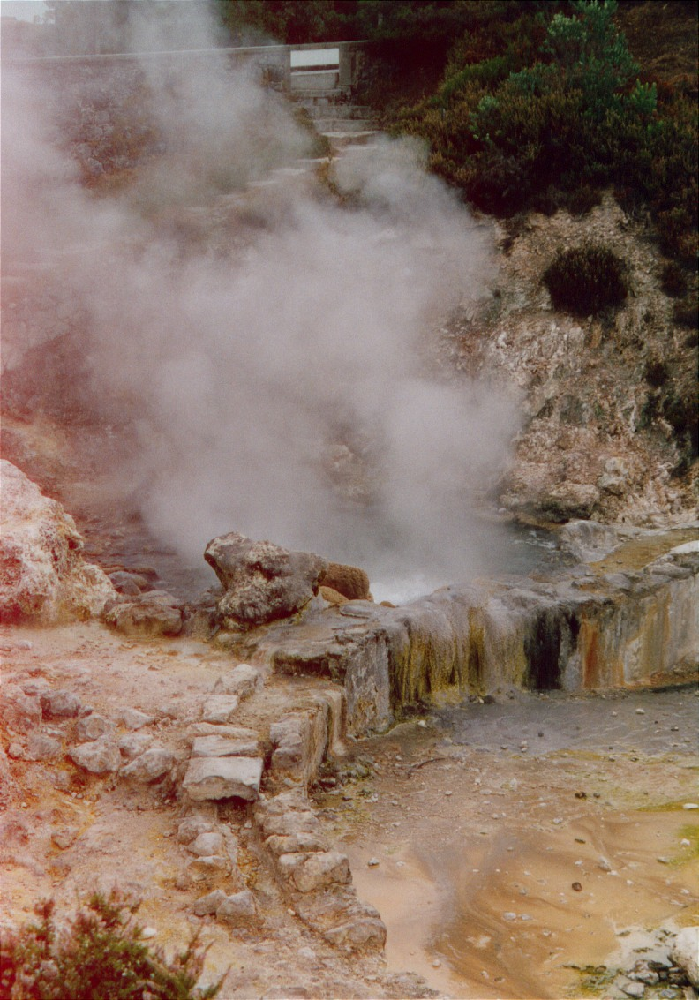
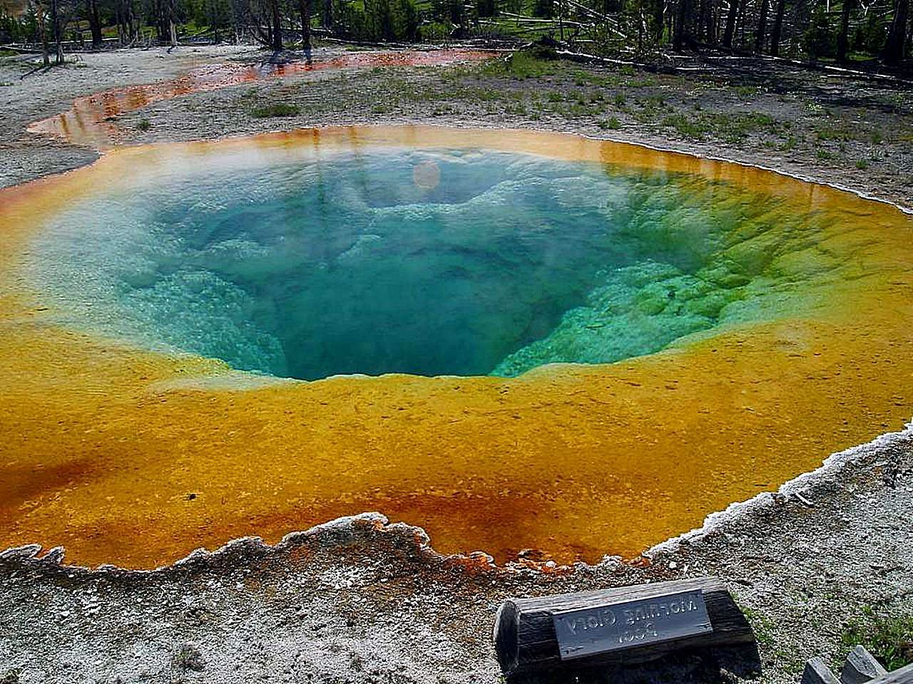

# Informe Ejecutivo de Progreso del Proyecto GeoterRA (2024–2026)

**Institución Ejecutora:** Universidad de Costa Rica (UCR) — Instituto de Investigaciones en Ingeniería (INII)  
**Plataforma:** GeoterRA — Sistema Nacional de Información Geotermal  
**Período del Proyecto:** Abril 2024 – Noviembre 2026 (6 semestres académicos UCR)  
**Fecha de Emisión:** Noviembre de 2026  

---

## 1. Resumen Ejecutivo

El proyecto **GeoterRA** nace en abril de 2024 en el **Instituto de Investigaciones en Ingeniería (INII) de la Universidad de Costa Rica (UCR)** con un propósito estratégico claro: recopilar, verificar científicamente, resguardar y poner a disposición del país la información sobre manifestaciones geotermales del territorio costarricense —tales como nacientes de aguas termales, fumarolas y surgencias hidrotermales—.

A lo largo de **seis semestres académicos consecutivos (2024–2026)**, GeoterRA evolucionó desde una propuesta exploratoria inicial hasta convertirse en una **plataforma institucional unificada** compuesta por un portal web interactivo y una aplicación móvil para trabajo de campo. Hoy, el sistema permite que tanto la ciudadanía como los equipos de investigación reporten sitios de interés, que los especialistas organicen giras de muestreo y análisis de laboratorio, y que la información validada se publique con precisión geográfica y respaldo técnico en formato digital y en reportes oficiales descargables en PDF.

> **Valor público e institucional:** GeoterRA cierra la brecha entre la observación ciudadana en comunidades, el rigor científico universitario y la toma de decisiones en materia energética, ambiental, turística y territorial en Costa Rica, garantizando que únicamente los datos revisados y aprobados por especialistas sean publicados como referencia oficial.

### Resumen de Capacidades Consolidadas

| Área de Impacto | Qué logra la plataforma hoy para el país y la UCR |
| :--- | :--- |
| **Mapa Nacional y Ubicación Oficial** | Visualización interactiva de manifestaciones geotermales en todo Costa Rica, organizada por provincia, cantón y distrito conforme a la nomenclatura oficial del Sistema Nacional de Información Territorial (SNIT). |
| **Portal Web Público e Institucional** | Espacio abierto de consulta ciudadana, educación sobre energía geotérmica, solicitud de análisis de nuevos sitios y gestión integral para equipos científicos y administrativos. |
| **Aplicación Móvil de Campo** | Herramienta portátil diseñada para teléfonos Android (y con base preparada para dispositivos iPhone) que facilita capturar coordenadas GPS, fotografías y formularios directamente desde zonas rurales o volcánicas. |
| **Rigor Científico y Gráficos Especializados** | Registro estructurado de mediciones realizadas en el sitio (temperatura, acidez y observaciones) junto con 14 análisis físico-químicos de laboratorio, representados automáticamente en gráficos científicos de fácil interpretación. |
| **Control de Calidad y Visibilidad** | Ningún dato sin verificar aparece como oficial: un coordinador científico revisa cada estudio y promueve la versión vigente para que se publique de forma coherente y segura. |
| **Giras de Campo y Fichas PDF** | Planificación ordenada de expediciones universitarias, bitácora compartida de observaciones y generación automática de fichas técnicas oficiales en PDF con el membrete institucional de la UCR. |

---

## 2. Evolución del Proyecto por Etapas (2024–2026)

El crecimiento de GeoterRA se planificó de manera gradual en seis etapas semestrales, pasando de comprobar la viabilidad de la idea en 2024 a consolidar una herramienta científica en operación hacia finales de 2026.

### 2.1 Primera Etapa — I Semestre 2024 (Abril – Julio 2024): Inicio del Proyecto y Primeros Prototipos

**Propósito de la Etapa:** Validar la viabilidad de reunir en un solo lugar reportes ciudadanos e investigativos sobre puntos termales y mostrarlos sobre un mapa digital interactivo de Costa Rica, iniciando al mismo tiempo los primeros ensayos de una aplicación móvil para trabajo en terreno.

**Principales Logros:**
- **Arranque formal del proyecto:** Diseño de la primera página informativa, pantallas iniciales de acceso para personas usuarias y estructura básica de almacenamiento de información.
- **Primer mapa exploratorio:** Visualización inicial de regiones geotérmicas del país y recepción de las primeras solicitudes de análisis de puntos termales.
- **Primer prototipo móvil:** Versión experimental para teléfonos Android orientada a registrar solicitudes directamente desde el campo.

### 2.2 Segunda Etapa — II Semestre 2024 (Agosto – Diciembre 2024): Identidad Institucional y Precisión Geográfica

**Propósito de la Etapa:** Dotar al proyecto de una identidad visual propia y profesional acorde con la Universidad de Costa Rica, proteger la información del sistema y asegurar que las ubicaciones geográficas coincidieran con los mapas oficiales del país.

**Principales Logros:**
- **Identidad oficial GeoterRA:** Adopción del Manual de Identidad Gráfica 2024 con los colores institucionales (Azul GeoterRA y Naranja Geotérmico) y una presentación unificada tanto en la web como en la aplicación móvil.
- **Compatibilidad cartográfica nacional:** Incorporación de conversión automática de coordenadas al estándar oficial costarricense (CRTM05 / SNIT), evitando desfases entre mediciones de campo y mapas gubernamentales.
- **Mejora de vistas de consulta:** Rediseño de las fichas de detalle para mostrar de forma más ordenada la información de cada sitio termal y el perfil de las personas usuarias.

### 2.3 Tercera Etapa — I Semestre 2025 (Marzo – Julio 2025): Modernización del Portal y Primera Versión Beta

**Propósito de la Etapa:** Renovar por completo la experiencia del portal web para hacerlo ágil, claro y fácil de usar desde computadoras o tabletas, diferenciando las herramientas disponibles según el rol de cada persona y alcanzando la primera versión de pruebas completa.

**Principales Logros:**
- **Portal web renovado y secciones informativas:** Implementación de una interfaz moderna junto con apartados claros para explicar a la población qué es el proyecto, cómo funciona y cómo contactar al equipo investigador.
- **Acceso diferenciado por perfiles:** Incorporación de sesiones seguras y paneles adaptados según el nivel de responsabilidad (ciudadanía, investigadores y administración).
- **Primera versión Beta funcional:** En julio de 2025 se consolidó la primera versión integral de pruebas con captura de fotografías, permisos de dispositivo y mapeo corregido de puntos termales.

### 2.4 Cuarta Etapa — II Semestre 2025 (Agosto – Diciembre 2025): Herramientas Científicas y Estabilidad Operativa

**Propósito de la Etapa:** Elevar el valor científico de la plataforma mediante gráficos hidrogeoquímicos especializados, fortalecer la independencia tecnológica de la aplicación móvil en zonas de campo y automatizar las actualizaciones del servicio.

**Principales Logros:**
- **Analítica visual para especialistas y público:** Integración del **Diagrama de Piper** (para identificar la composición y el origen químico del agua termal) y del **Diagrama de Lindal** (que orienta sobre posibles aprovechamientos según la temperatura, desde balneología y agricultura hasta generación eléctrica).
- **Mayor autonomía de ubicación en campo:** Mejora en la captura de ubicación GPS desde la aplicación móvil sin depender de servicios cerrados de terceros, aumentando su confiabilidad en zonas alejadas.
- **Continuidad operativa:** Estandarización de los procesos de actualización para reducir errores manuales al publicar mejoras.

### 2.5 Quinta Etapa — I Semestre 2026 (Enero – Julio 2026): Reestructuración Integral y Alcance Multiplataforma

**Propósito de la Etapa:** Ejecutar una renovación profunda de toda la plataforma para garantizar estabilidad a largo plazo, ampliar la compatibilidad móvil tanto para Android como para iPhone (iOS), integrar la división territorial completa de Costa Rica y formalizar el acceso web institucional de la UCR.

**Principales Logros:**
- **Base tecnológica sólida y verificada:** Reorganización completa del núcleo del sistema con controles automáticos de calidad, garantizando integridad de los registros y prevención de errores en las operaciones diarias.
- **División territorial oficial completa:** Integración íntegra del catálogo del SNIT con el detalle oficial de Costa Rica (provincias, **85 cantones** y **495 distritos**) para clasificar y filtrar cada sitio con exactitud administrativa.
- **Expansión a Android e iPhone (iOS):** Unificación de la aplicación móvil para operar en ambos ecosistemas, con registro fotográfico nativo, captura de fecha/ubicación automática y consulta directa en terreno.
- **Seguridad y dominio institucional UCR:** Publicación bajo entorno institucional seguro con cifrado de comunicaciones y trazabilidad completa del historial de cada solicitud recibida.

### 2.6 Sexta Etapa — II Semestre 2026 (Agosto – Noviembre 2026): Operación en Producción, Giras y Reportes PDF

**Propósito de la Etapa:** Completar las funciones operativas que necesita el equipo investigador en su trabajo diario, reforzar la transparencia y trazabilidad científica, automatizar la comunicación por correo electrónico y entregar reportes formales listos para uso institucional.

**Principales Logros:**
- **Módulo de Giras de Campo:** Planificación de expediciones científicas, asignación de investigadores participantes y vinculación directa con los sitios geotermales visitados.
- **Bitácora colaborativa de observaciones:** Registro ordenado de notas y seguimiento sobre solicitudes, giras de campo y sitios estudiados para mantener memoria institucional entre equipos.
- **Publicación controlada por validación científica:** Cuando un coordinador aprueba un nuevo estudio, el sistema actualiza automáticamente la ficha oficial y libera de forma coordinada los datos de campo y laboratorio para consulta pública.
- **Notificaciones automáticas por correo:** Envío automático de códigos de recuperación de contraseña y avisos oportunos cuando una solicitud ciudadana o investigativa cambia de estado.
- **Diseño unificado y exportación oficial en PDF:** Estandarización visual de todas las pantallas de gestión y emisión automática de **fichas hidrogeoquímicas en PDF** con el logotipo y encabezado oficial UCR/INII tanto desde la web como desde el teléfono.
- **Distribución directa de la aplicación móvil:** Disponibilidad de versiones listas para instalar en dispositivos Android utilizados durante las giras de campo del INII.

---

## 3. Cómo Funciona la Plataforma y Flujo de Validación

### 3.1 Comparativa de Avance: Inicio (2024) vs. Situación Actual (2026)

| Aspecto | Situación Inicial (Abril 2024) | Plataforma Actual en Operación (Noviembre 2026) |
| :--- | :--- | :--- |
| **Experiencia en Portal Web** | Páginas básicas informativas con funciones limitadas y diseño preliminar. | Portal ágil, adaptable a cualquier pantalla, con mapa nacional interactivo, buscadores territoriales y paneles especializados por perfil. |
| **Aplicación Móvil de Campo** | Versión experimental inicial únicamente para pruebas básicas en Android. | Aplicación estructurada para trabajo real en Android (con base compartida compatible con iOS), cámara integrada, ubicación GPS y exportación PDF. |
| **Precisión Territorial** | Ubicaciones generales sin catálogo administrativo completo. | Compatibilidad con coordenadas oficiales costarricenses (CRTM05 / WGS84) y clasificación exacta por provincias, 85 cantones y 495 distritos del SNIT. |
| **Análisis Científico** | Registro simple de puntos en el mapa sin gráficos ni datos químicos procesados. | Evaluación completa con mediciones en sitio, 14 parámetros de laboratorio y generación automática de diagramas de Piper y Lindal. |
| **Seguridad y Roles** | Acceso básico sin diferenciación clara de permisos institucionales. | Cinco niveles de acceso claramente definidos, protección de sesiones y recuperación de cuentas mediante verificación por correo. |
| **Comunicación y Reportes** | Seguimiento manual fuera de la plataforma y sin generación de documentos. | Notificaciones automáticas por correo electrónico, bitácora interna de seguimiento y descarga inmediata de fichas oficiales en PDF. |

### 3.2 Flujo de Revisión y Publicación de Datos Validados

1. **Envío de solicitud:** Una persona ciudadana o investigadora registra un posible sitio geotermal desde el portal web o la aplicación móvil, indicando ubicación GPS y observaciones.
2. **Registro y confirmación:** La plataforma guarda la solicitud en estado *Pendiente* y envía un correo automático de confirmación.
3. **Gira de campo y laboratorio:** La coordinación científica asigna una gira de campo, el equipo realiza mediciones en el terreno (*in-situ*) y registra los análisis de agua en laboratorio.
4. **Aprobación oficial:** El coordinador científico revisa la consistencia del estudio y aprueba su publicación como reporte vigente.
5. **Consulta pública y PDF:** La información validada aparece en el mapa nacional junto con sus diagramas científicos y queda lista para descargarse como ficha oficial en PDF.

---

## 4. Estado Actual del Producto y Proyección 2027

### 4.1 Beneficios y Funciones Disponibles Hoy (Noviembre 2026)

- **Para la Ciudadanía y el Sector Público:** Consulta abierta del mapa geotermal de Costa Rica con filtros por provincia, cantón y distrito; acceso a fichas explicativas con gráficos visuales sobre temperatura, composición química del agua y posibles usos sostenibles; descarga directa de reportes en PDF con respaldo de la UCR; y envío de nuevas solicitudes de análisis con seguimiento del estado de trámite.
- **Para Equipos de Investigación y Trabajo de Campo:** Planificación y seguimiento de giras de campo; registro ordenado de mediciones tomadas en el terreno y de 14 parámetros físico-químicos de laboratorio; captura de fotografías desde la aplicación móvil Android; y bitácora compartida de observaciones.
- **Para la Coordinación Científica:** Revisión y control de calidad de cada solicitud recibida; autorización explícita para decidir qué estudios pasan a consulta pública; y coherencia automática entre el reporte oficial vigente y sus pruebas científicas asociadas.
- **Para la Administración y Continuidad del Servicio:** Gestión segura de cuentas y perfiles de usuario, envío automatizado de notificaciones institucionales por correo electrónico y herramientas de supervisión del funcionamiento general.

### 4.2 Evidencia de Campo de Recursos Geotérmicos Catalogados

| Manifestación Fumarólica | Naciente de Agua Termal | Reconocimiento Territorial con Dron |
| :---: | :---: | :---: |
|  |  |  |

### 4.3 Proyección y Próximos Pasos (2027)

1. **Registro sin Conexión en Zonas Remotas:** Habilitar el almacenamiento temporal en el teléfono para que los investigadores puedan completar formularios, mediciones y fotografías en zonas volcánicas o montañosas sin señal celular, enviando los datos automáticamente al recuperar conexión.
2. **Publicación en Tiendas Oficiales de Aplicaciones:** Completar los trámites de registro institucional para distribuir la aplicación de manera directa a través de Google Play Store y Apple App Store, simplificando su descarga y actualización para toda la comunidad.
3. **Ampliación de Controles de Calidad y Seguimiento:** Reforzar las verificaciones automáticas de los procesos más importantes y consolidar tableros de monitoreo operativo para garantizar disponibilidad continua.
4. **Intercambio de Datos Abiertos con Instituciones Nacionales:** Facilitar mecanismos estandarizados de exportación de datos validados para fortalecer la colaboración con instituciones costarricenses del sector energético, ambiental y geocientífico (como ICE, MINAE y OVSICORI).

---

**Elaborado para:** Dirección del Proyecto GeoterRA y autoridades institucionales — Instituto de Investigaciones en Ingeniería (INII), Universidad de Costa Rica.
