# Informe Ejecutivo y Técnico del Progreso de Desarrollo de GeoterRA (2024–2026)

**Institución:** Universidad de Costa Rica (UCR) — Instituto de Investigaciones en Ingeniería (INII)  
**Plataforma:** GeoterRA — Sistema Multiplataforma de Gestión, Análisis Hidrogeoquímico y Visualización Geotermal  
**Período Evaluado:** 6 de abril de 2024 – 12 de noviembre de 2026 (6 semestres académicos UCR)  
**Fecha de Emisión:** 18 de noviembre de 2026  
**Responsable Técnico:** Líder Técnico e Investigador Académico (UCR / INII)

---

## 1. Resumen Ejecutivo

El proyecto **GeoterRA** surge en abril de 2024 en el seno de la **Universidad de Costa Rica (UCR)** y el **Instituto de Investigaciones en Ingeniería (INII)** con el objetivo estratégico de digitalizar, centralizar, validar científicamente y divulgar información sobre manifestaciones geotermales en el territorio costarricense. A lo largo de **seis semestres académicos consecutivos (I-2024 a II-2026)**, la iniciativa evolucionó desde un prototipo web estático en HTML/PHP acompañado de una aplicación Android experimental hasta consolidarse en una **plataforma institucional de arquitectura limpia, multiplataforma (Web, Android e iOS), respaldada por pruebas unitarias automatizadas y flujos CI/CD de despliegue continuo**.

La auditoría forense ejecutada sobre el repositorio oficial `GeoterRA_DEV/` —abarcando la totalidad de sus ramas (`origin/main`, `origin/develop`, `origin/API`, `origin/web`, `origin/mobile`)— contabiliza **1,657 commits** entre el commit fundacional (`a905ad29`, **6 de abril de 2024**) y la sincronización más reciente de producción (`e6aa80dd`, **12 de noviembre de 2026**). Durante este ciclo de 31 meses, la plataforma pasó de ejecutar consultas SQL acopladas en scripts PHP procedurales a operar una API REST desacoplada en **PHP >= 8.1 / 8.5** con **87 rutas activas**, **28 DTOs**, **44 suites de pruebas unitarias PHPUnit**, una base de datos **MariaDB** con **19 tablas base + 1 vista SQL (`view_logs_entries`)** indexada mediante **ULID (`CHAR(26)`)**, un cliente web en **React 18 + Vite + Tailwind CSS + Ant Design + Leaflet**, y una aplicación móvil nativa compartida mediante **Kotlin Multiplatform (KMP) y Compose Multiplatform** con artefactos compilados para Android (`geoterraApp-1.0.0-beta2.apk`) e iOS.

### Tabla Resumen de Métricas Globales (Abril 2024 – Noviembre 2026)

| Indicador Global | Cifra Verificada | Fuente / Respaldo en Repositorio |
| :--- | :--- | :--- |
| **Commits Totales (`git log --all`)** | **1,657 commits** | `06/04/2024` (`a905ad29`) al `12/11/2026` (`e6aa80dd`) |
| **Distribución por Ramas Remotas** | `origin/web` (1,269) · `origin/API` (1,234) · `origin/develop` (1,202) · `origin/mobile` (1,198) · `origin/main` (854) | Historial completo multirrama en `GeoterRA_DEV/.git` |
| **Colaboradores y Automatización** | **Mario Cordero** (826 manuales + 72 CI = 898) · **Aarón Carmona Sánchez** (493) · **Christopher Acosta** (70) · **GitHub Actions Bot** (196) | `git log --all --format='%an|%ae'` consolidado por identidad |
| **Base de Datos Relacional** | **19 tablas** + **1 vista (`view_logs_entries`)** · **6 migraciones** (`001`–`006`) · **588 registros SNIT** (8 prov., 85 cant., 495 dist.) | `database/GeoterRA_schema.sql`, `migrations/`, `GeoterRA_catalogs.sql` |
| **Backend API REST (PHP)** | **87 rutas activas** en **14 módulos** · **14 Controladores** · **17 Servicios** · **15 Repositorios** · **28 DTOs** | `API/config/routes.php`, `API/src/`, `Doc API GeoterRA.md` |
| **Cobertura de Pruebas (Backend)** | **44 archivos de pruebas unitarias PHPUnit** (`DTO`, `Services`, `Platform/Web`, `Platform/Mobile`) | `API/tests/Unit/` y `API/composer.json` |
| **Frontend Web (React SPA)** | **5 páginas públicas/privadas** · **19 vistas de gestión en Dashboard** · **4 módulos cartográficos/científicos** | `website/src/pages/`, `loggedComponents/views/`, `mapComponents/` |
| **Aplicación Móvil (KMP)** | **18 pantallas Voyager** (`Screen.kt`) · **45 componentes UI Compose** · **2 releases APK** (`beta1`, `beta2`) | `Mobile/GeoterRa/geoterraApp/`, `Mobile/Releases/Android/` |
| **Control de Acceso (RBAC)** | **5 roles institucionales**: `admin`, `maintenance`, `field_investigator`, `investigator`, `user` | `API/src/DTO/AllowedUserRoles.php`, `database/GeoterRA_schema.sql` |

### Comportamiento Estadístico del Desarrollo (2024–2026)

La gráfica siguiente evidencia la aceleración exponencial de la cadencia de ingeniería: tras una fase fundacional y de consolidación estable entre I-2024 y I-2025 (107–114 commits/semestre), la adopción de flujos de CI/CD en II-2025 duplicó la cadencia (206 commits) y la reingeniería total de I-2026 alcanzó un máximo histórico de **539 commits en el semestre lectivo** (+ **117 commits** en el interciclo preparatorio de enero–febrero 2026 = **656 commits** en el bloque enero–julio), manteniendo **467 commits** de despliegue, estabilización y nuevas funcionalidades en II-2026.

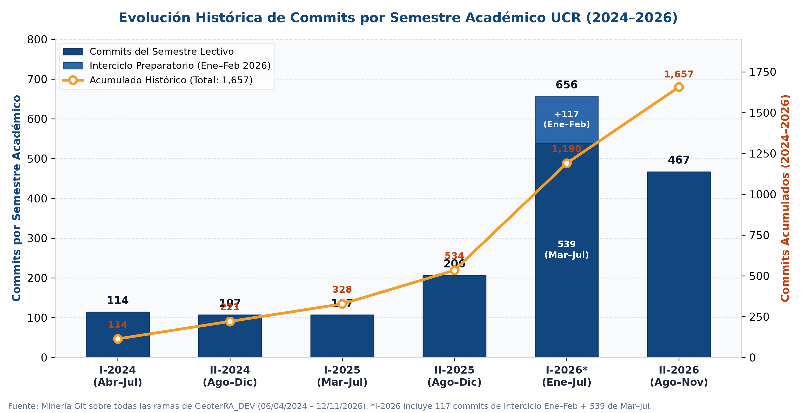

De manera complementaria, el análisis de impacto directo por módulo demuestra cómo el foco de ingeniería transitó desde el prototipado visual web en 2024 hacia una arquitectura equilibrada y altamente activa en **API/Backend (300 commits en Ene–Jul 2026 y 215 en Ago–Nov 2026)**, **Móvil KMP**, **Frontend React** y **Base de Datos / DevOps**.

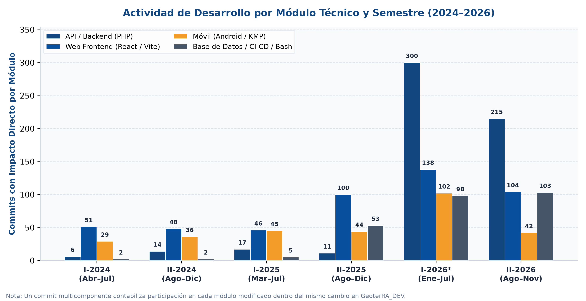

---

## 2. Evolución Semestral Detallada (I-2024 a II-2026)

### 2.1 I Semestre 2024 (Abril – Julio 2024): Inicio del Proyecto, Arquitectura Base y Primeros Prototipos

#### Objetivos y Enfoque del Período
El primer semestre marcó el nacimiento oficial del proyecto GeoterRA en la UCR. El propósito central fue validar la viabilidad técnica de capturar reportes ciudadanos e investigativos sobre puntos termales y representarlos sobre una cartografía digital interactiva de Costa Rica, sentando simultáneamente las bases de una aplicación móvil de campo en Android.

#### Hitos Técnicos Alcanzados
- **Fundación del Repositorio y Estructura Inicial:** Creación del repositorio el **6 de abril de 2024** (`a905ad29`, *"Initial commit"*), seguida del primer boceto de la página de aterrizaje (`33a6b107`, 09/04/2024) y la configuración inicial del proyecto Android nativo en Kotlin (`98032492`, 09/04/2024).
- **Backend/API y Base de Datos Temprana:** Establecimiento de la primera conexión a base de datos relacional (`8605c9b5`, `45f05c21`, 13/04/2024), lógica inicial de autenticación/registro de usuarios (`14026e2d`, `443b21e5`), gestión de sesiones PHP (`234fab18`, 28/06/2024) y creación de los primeros scripts PHP para recepción de solicitudes de análisis (`d2850851`, `c34541db`, 15/07/2024).
- **Frontend Web Prototipo:** Implementación de pantallas HTML/CSS/JS de inicio de sesión (`317ad111`), visualización de solicitudes (`313a1029`), diseño responsivo del visor inicial (`3b8a1ae0`, `dfaaa032`), control de capas por regiones geotérmicas en el mapa (`0dd003c7`, `05d06c33`, 22/06/2024) y el primer experimento visual del Diagrama de Piper (`fd191785`).
- **Aplicación Móvil (Android Nativo):** Implementación de la navegación inferior (`c3c48c91`, `BottomNavigationMenu`), flujo de registro (`29105e5c`, `signUpFragment`) y creación de solicitudes de análisis desde el teléfono (`9c63e656`, `e3db097c`, 24/07/2024).

#### Tabla de Métricas — I Semestre 2024

| Métrica | Valor Registrado | Detalle Verificado |
| :--- | :--- | :--- |
| **Commits Totales** | **114 commits** | Abr: 24 · May: 37 · Jun: 25 · Jul: 28 |
| **Autores Activos** | **3 desarrolladores** | Aarón Sánchez / Svndda (48), Mario Cordero (36), Christopher Acosta (30) |
| **Ramas Activas** | `main`, `headerWeb`, `headerAndroid`, `testing` | 24 merges registrados entre ramas de trabajo web y móvil |
| **Archivos Únicos Modificados** | **432 archivos** | Impactos por módulo: `website` (51 commits), `Android` (29), `API` (6), `database` (2) |
| **Componentes Clave Creados** | Prototipo HTML/JS + PHP + Android | Landing, login/registro, mapa por regiones, `BottomNavigationMenu`, formulario de solicitud |

#### Evidencia Visual — I Semestre 2024

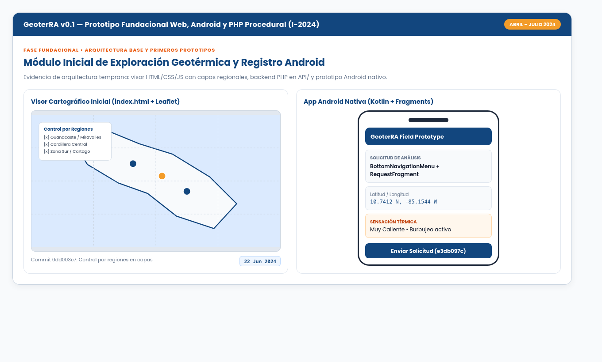

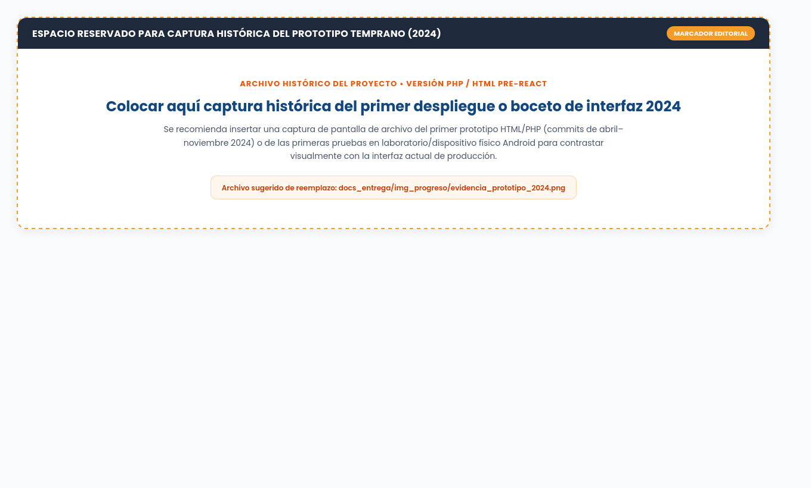

> **Nota editorial sobre evidencia histórica (I-2024):** En el espacio superior puede sustituirse `img_progreso/evidencia_captura_historica_nota.png` por una captura de pantalla original de archivo del primer prototipo HTML/PHP desplegado en abril–julio de 2024 o fotografías de las sesiones iniciales de diseño con el equipo investigador.

---

### 2.2 II Semestre 2024 (Agosto – Diciembre 2024): Evolución del Backend, Identidad Visual y Primeras Vistas Funcionales

#### Objetivos y Enfoque del Período
Superada la fase exploratoria, el II Semestre 2024 se enfocó en dotar al sistema de una identidad gráfica institucional coherente, asegurar el manejo de credenciales de base de datos, resolver la interoperabilidad geodésica oficial de Costa Rica y modernizar las primeras vistas funcionales del portal web y móvil.

#### Hitos Técnicos Alcanzados
- **Identidad Institucional y Estandarización Tipográfica:** Incorporación del **Manual de Identidad GeoterRA 2024** (`3d0ff8c1`, 26/08/2024) en el repositorio y adopción oficial de la paleta Azul GeoterRA / Naranja Geotérmico junto con las fuentes **Poppins** y **League Spartan** tanto en la web como en la aplicación Android (`65de914d`, `76aa78d1`, 05/11/2024).
- **Backend/API y Seguridad de Credenciales:** Integración directa de los endpoints PHP en la aplicación web (`8026b1cd`, `72e79336`, 23/08/2024) y migración del manejo de credenciales hacia archivos `.config` desacoplados del código fuente (`4cd7b9fe`, `0e2d093b`, `cd877763`, 16/10/2024).
- **Frontend Web y Adopción de Tailwind CSS:** Rediseño completo de la vista autenticada `logged.html` y del detalle de puntos `show-point` (`30255a24`, `f7b27cc6`, `4ac1e4b2`), incorporación de **Tailwind CSS** (`91ce7915`, `f593edf0`, 09/11/2024) y generalización de cabeceras y pies de página dinámicos en `.php` (`a8fd19e8`, 10/11/2024).
- **Aplicación Móvil y Geodesia CRTM05:** Refactorización de gestión asíncrona IO mediante `Lifecycle` (`a378a3d8`), implementación de la función de conversión geodésica **CRTM05 a WGS84** en `RequestSheet` para compatibilidad con datos oficiales del SNIT (`4d3253d7`, 16/10/2024), sincronización de campos API (`45e6ddb5`) y consulta de perfil `userInformation` (`13bdb866`, 20/11/2024).

#### Tabla de Métricas — II Semestre 2024

| Métrica | Valor Registrado | Detalle Verificado |
| :--- | :--- | :--- |
| **Commits Totales** | **107 commits** | Ago: 20 · Sep: 43 · Oct: 18 · Nov: 26 |
| **Autores Activos** | **3 desarrolladores** | Aarón Sánchez / Svndda (41), Mario Cordero (41), Christopher Acosta (25) |
| **Ramas Activas** | `main`, `headerWeb`, `headerAndroid`, `testing` | 16 merges consolidados hacia `testing` y `main` |
| **Archivos Únicos Modificados** | **13,500 archivos** | Incluye integración de dependencias frontend (`Tailwind`) · Commits: Web (48), Mobile (36), API (14), DB (2) |
| **Componentes Clave Creados** | Manual Identidad 2024, `.config`, CRTM05–WGS84 | Plantillas PHP compartidas, vistas `logged`/`show-point`, `userInformation` en Android |

#### Evidencia Visual — II Semestre 2024

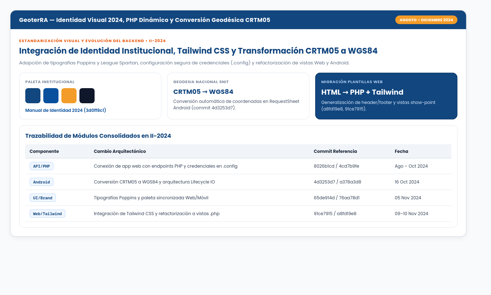

---

### 2.3 I Semestre 2025 (Marzo – Julio 2025): Consolidación de Módulos Core, Migración a React y Primera Beta

#### Objetivos y Enfoque del Período
El I Semestre 2025 representó el punto de inflexión tecnológica del frontend web. Se abandonó la manipulación directa del DOM sobre páginas HTML/PHP monolíticas para migrar la experiencia completa hacia una aplicación SPA moderna basada en **React + Vite + Tailwind CSS + Ant Design**, culminando con el lanzamiento de la **Primera Beta funcional** del ecosistema GeoterRA.

#### Hitos Técnicos Alcanzados
- **Migración Web a React 18, Vite y Ant Design:** Configuración del entorno React sobre la plataforma (`e25081be`, `74df41a9`, `f63f17bd`, abril 2025), integración de la librería empresarial **Ant Design** (`2ae939bd`, 19/05/2025) y desarrollo de los módulos informativos institucionales `About-us`, `How Works` y `Contact Us` (`749e2c6e`, `d8e6551e`, `31240d9d`).
- **Consolidación de Roles y Sesiones en Web y API:** Implementación de un nuevo protocolo de comunicación API y manejo de sesiones activas (`585c84b0` a `3a2f1bd6`, 03/07/2025), incorporación de control de **roles en la plataforma web**, encabezados de sesión activa y barras laterales (`Sidebar`) adaptadas por rol (`b565d2f3`, 10/07/2025).
- **Aplicación Móvil (Estabilización y ViewBinding):** Refactorización de clases y paquetes para alinear la interfaz con el prototipo de Figma (`c3290a2c`, `57a14f84`), adopción de `ViewBinding` y abstracción de lógica en `PageFragment` (`d1fc05bc`, `2b00be1d`), manejo formal de permisos de galería y almacenamiento (`b05b29d3`, `509b2807`), y corrección del mapeo latitud/longitud en `ThermalPoint` (`228e0e5a`, 03/07/2025).
- **Base de Datos y Primera Versión Beta:** Generación del respaldo estructurado de la base de datos (`7622165b`, 11/07/2025) y liberación del hito **Primera BETA de la aplicación** con todas las funcionalidades mínimas operativas en etapa de pruebas (`bb15fd93`, 11/07/2025).

#### Tabla de Métricas — I Semestre 2025

| Métrica | Valor Registrado | Detalle Verificado |
| :--- | :--- | :--- |
| **Commits Totales** | **107 commits** | Mar: 1 · Abr: 8 · May: 35 · Jun: 33 · Jul: 30 |
| **Autores Activos** | **3 desarrolladores** | Aarón Sánchez / Svndda (48), Mario Cordero (46), Christopher Acosta (13) |
| **Ramas Activas** | `main`, `headerWeb`, `Features`, `testing` | 8 merges destacados (incl. PR #21 hacia rama principal) |
| **Archivos Únicos Modificados** | **10,861 archivos** | Commits por módulo: Web (46), Mobile (45), API (17), DB/DevOps (5) |
| **Componentes Clave Creados** | SPA React + Ant Design + Sidebar por Roles | `ThermalPoint`, `ViewBinding`, protocolo sesiones API, Primera Beta (11/07/2025) |

#### Evidencia Visual — I Semestre 2025

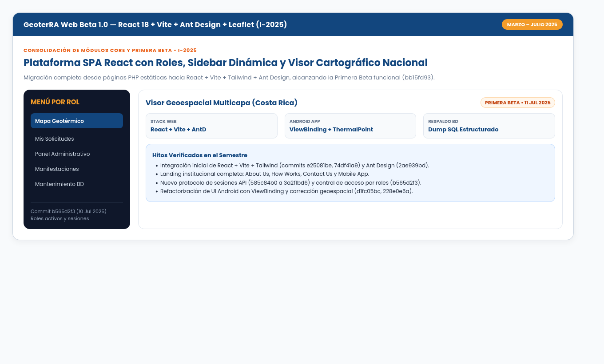

---

### 2.4 II Semestre 2025 (Agosto – Diciembre 2025): Arquitectura MVVM Móvil, Analítica Hidrogeoquímica y CI/CD

#### Objetivos y Enfoque del Período
Con una versión Beta operativa, el II Semestre 2025 se dedicó a elevar el rigor científico de la visualización web —implementando gráficos especializados de geotermia e hidrogeoquímica—, reestructurar la aplicación móvil bajo el patrón **MVVM** libre de dependencias propietarias cerradas, y automatizar los despliegues mediante **GitHub Actions**.

#### Hitos Técnicos Alcanzados
- **Módulo Científico Web (Diagrama de Piper y Lindal):** Culminación de la implementación matemática y gráfica interactiva del **Diagrama de Piper** con proyecciones ternarias de cationes y aniones sobre el rombo hidrogeoquímico (`a1d1f89c` a `77544bf5`, PR #53 del 12/12/2025), complementado con la escala térmica del **Diagrama de Lindal** para clasificación de usos directos de energía geotérmica.
- **Refactorización MVVM en Móvil y Desacoplamiento GPS:** Migración de las vistas Android al patrón **MVVM** (`PageViewModel.kt`, `6fb7ee55`, 16/08/2025), creación de observadores de ciclo de vida y `PermissionRequester.kt` (`92eb3ef1`, `6c9e9aec`), y eliminación de la dependencia propietaria `FusedLocation` de Google (`b40b04d3`, 16/08/2025) en favor de un `LocationCallbackListener.kt` nativo desacoplado.
- **Configuración Dinámica de Entornos y Automatización CI/CD:** Implementación de `apiConf` en Web para conmutar ágilmente entre el servidor local de desarrollo y el servidor productivo del INII (`fe016481`, `7d3c998e`, 16/08/2025), refactorización de `RegisterForm` (PR #51) y `RequestSheet` (PR #52), y puesta en marcha de los primeros pipelines de despliegue automático en `.github/workflows/` (`8c38e60b`, `91f61919`).

#### Tabla de Métricas — II Semestre 2025

| Métrica | Valor Registrado | Detalle Verificado |
| :--- | :--- | :--- |
| **Commits Totales** | **206 commits** | Ago: 97 · Sep: 6 · Oct: 28 · Nov: 65 · Dic: 10 |
| **Autores y Automatización** | **3 desarrolladores + CI** | Mario Cordero (146 + 8 CI = 154), Aarón Sánchez (43), GitHub Actions (8), Chris4Fun (1) |
| **Ramas Activas** | `main`, `headerWeb`, `refractPiper`, `Refact-RequestSheet`, `refractRegisterForm` | 10 merges (PRs #51, #52, #53) y flujos iniciales de CI |
| **Archivos Únicos Modificados** | **573 archivos** | Commits por módulo: Web (100), DB/DevOps/CI (53), Mobile (44), API (11) |
| **Componentes Clave Creados** | `PiperDiagram.jsx`, `PageViewModel.kt`, CI/CD | Configurador `apiConf`, `PermissionRequester.kt`, workflows GitHub Actions |

#### Evidencia Visual — II Semestre 2025

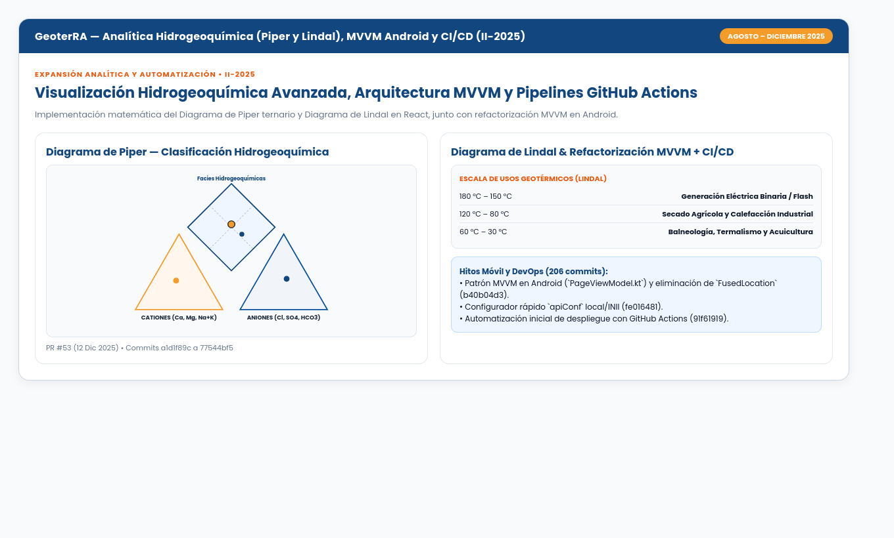

---

### 2.5 I Semestre 2026 (Enero – Julio 2026): Reingeniería de Arquitectura Limpia, KMP Multiplataforma y Calidad PHPUnit

#### Objetivos y Enfoque del Período
Este período constituyó la transformación estructural más profunda en la historia de GeoterRA. Iniciado con un intenso **interciclo preparatorio en enero y febrero de 2026 (117 commits)** y consolidado durante el **semestre lectivo marzo–julio de 2026 (539 commits)** —totalizando **656 commits en siete meses**—, el equipo ejecutó una reingeniería completa de la API hacia una **Arquitectura Limpia Orientada a Objetos**, migró la app Android hacia **Kotlin Multiplatform (KMP)** con soporte simultáneo para **Android e iOS**, adoptó identificadores **ULID** en la base de datos e instauró pruebas unitarias automatizadas y portales de documentación técnica.

#### Hitos Técnicos Alcanzados
- **Reingeniería Total del Backend/API en Capas (PHP 8.1+ / 8.5):**
  - Relegación de los antiguos scripts procedurales a `API/legacy/` (29 archivos preservados para trazabilidad) e instauración de una arquitectura limpia en `API/src/`: `SimpleRouter.php`, **14 Controladores**, **17 Servicios**, **15 Repositorios**, **28 DTOs** con validación estricta en tiempo de instanciación, y manejo global de errores (`ApiException.php`, `ErrorType.php`, `GlobalErrorHandler.php`) bajo formato uniforme `{ data, meta, errors }`.
  - **Seguridad Dual por Plataforma:** Implementación de `X-API-Key` por plataforma (`web-secret-key`, `android-key`, `ios-key`), autenticación Web mediante **cookies HTTP-only** (`geoterra_session_token`), y autenticación Móvil mediante **Bearer Access Token + Refresh Token Rotation** con `family_id` para detección de reuso (`TokensRotationDTO.php`).
- **Base de Datos Relacional ULID y Catálogos SNIT:**
  - Adopción de llaves primarias **ULID (`CHAR(26)`)** ordenables cronológicamente en todas las entidades principales mediante `UlidGenerator.php` (`symfony/uid`).
  - Incorporación íntegra del catálogo territorial oficial de Costa Rica (**SNIT**): **8 provincias**, **85 cantones** y **495 distritos** (`GeoterRA_catalogs.sql`, PR #87 `d6fa1e16`), además del trigger SQL `prevent_double_use_before_insert` sobre `refresh_tokens`.
- **Expansión Multiplataforma con Kotlin Multiplatform (KMP):**
  - Creación de `Mobile/GeoterRa/` con código compartido en `commonMain` y módulos específicos `androidMain` e `iosMain` (integración CocoaPods `0aa9d5a4`, soporte nativo de cámara, galería con metadatos **EXIF** `8a03c8f2` y localización GPS multiplataforma `fb12fdf2`), inyección de dependencias con **Koin**, red con **Ktor** y navegación reactiva con **Voyager**.
- **Pruebas Unitarias, Documentación y Dominio Institucional UCR:**
  - Creación de **44 suites de pruebas unitarias con PHPUnit 11 + Mockery + ParaTest** cubriendo `DTO/`, `Services/` y `Platform/` (`65dbdc38`, `8bd88856`, `e84b79e1`), ejecutables tanto localmente como en GitHub Actions.
  - Despliegue del sitio de documentación interactiva en **Docusaurus** (`docApiWebsite/`) y redacción de `Doc API GeoterRA.md` (`76e0a162`).
  - Configuración del dominio institucional UCR con HTTPS (`fb364017`, `2c846632`) y trazabilidad de historial de estados en solicitudes (`725fb2c0`, `d9115a52`).

#### Tabla de Métricas — I Semestre 2026

| Métrica | Valor Registrado | Detalle Verificado |
| :--- | :--- | :--- |
| **Commits Totales** | **539** *(Mar–Jul)* + **117** *(Ene–Feb)* = **656** | Ene: 47 · Feb: 70 · Mar: 134 · Abr: 206 · May: 60 · Jun: 31 · Jul: 108 |
| **Autores y CI** | **3 desarrolladores + CI** | Bloque Ene–Jul: Mario Cordero (433), Aarón Carmona Sánchez (219), GitHub Actions (3), Chris4Fun (1) |
| **Ramas Activas** | `develop`, `main`, `API`, `web`, `mobile`, `refact-API-mario`, `refactor/api`, `fix-snitcode-params` | 43 merges en Mar–Jul + 1 en Ene–Feb |
| **Archivos Únicos Modificados** | **54,138** *(Mar–Jul)* + **456** *(Ene–Feb)* | Incluye portal `docApiWebsite` · Commits Ene–Jul: API (300), Web (138), Mobile (102), DB/CI (98) |
| **Componentes Clave Creados** | API Limpia PHP, KMP iOS/Android, 44 PHPUnit, Docusaurus | `SimpleRouter`, `UlidGenerator`, `TokenManager`, `AllowedUserRoles`, `GeoterRA_schema.sql` |

#### Evidencia Visual — I Semestre 2026

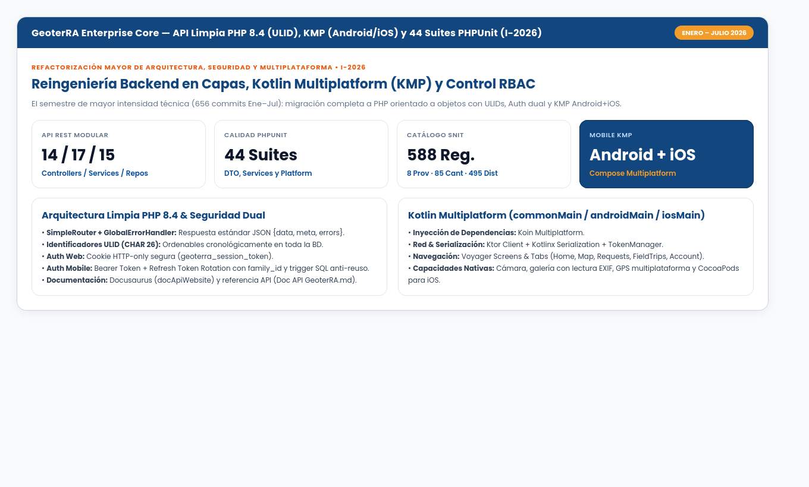

---

### 2.6 II Semestre 2026 (Agosto – Noviembre 2026): Producción, Giras de Campo, Cascada de Visibilidad y Releases

#### Objetivos y Enfoque del Período
El segundo semestre de 2026 consolidó a GeoterRA como un sistema en producción estable para el INII y la comunidad científica costarricense. Se incorporaron módulos avanzados de planificación logística (**Giras de Campo**), colaboración científica (**Comentarios Polimórficos**), gobernanza de publicación (**Promoción de Georeportes y Cascada de Visibilidad**), comunicación automatizada (**SMTP**), estandarización total de interfaz (`SkillWebDesignGeoterRA.md`), exportación oficial en **PDF** y publicación de artefactos Android para distribución en campo.

#### Hitos Técnicos Alcanzados
- **Migraciones Incrementales de Base de Datos (`003` a `006`) y Nuevos Módulos:**
  - **Giras de Campo (`field_trips`, `field_trip_participants`):** Gestión completa de expediciones científicas, asignación de investigadores mediante `UserSelectModal.jsx` con filtros por rol en español (`9b8c017e`) y vinculación directa con geomanifestaciones (`FieldTripsManager.jsx`, `FieldTripScreen.kt`).
  - **Comentarios Polimórficos (`comments`):** Sistema transversal de bitácora y observaciones asociado a `field_trip`, `request` o `geomanifestation` (`CommentsPanel.jsx`, `CommentController.php`).
  - **Promoción y Cascada de Visibilidad (`004_add_visibility_to_georeports_and_tests.sql`):** Endpoints `PATCH /admin/georeports/{id}/promote` y `PATCH /admin/geomanifestations/{id}/visibility` que propagan de manera coherente la publicación pública hacia el georeporte vigente, sus pruebas *in-situ* y sus análisis químicos de laboratorio (14 parámetros físico-químicos).
  - **Nomenclatura Estandarizada (`006_add_name_to_tests_and_reports.sql`):** Adición de nombres descriptivos `insitu_test_name`, `inlab_test_name` y `georeport_name` en pruebas y reportes.
- **Notificaciones Institucionales SMTP y Seguridad:**
  - Integración de `SmtpEmailService.php` y `NotificationService.php` (PHPMailer) para recuperación de contraseñas con códigos OTP (`3ec568d8`), alertas de cambio de estado en solicitudes (`5e10111d`, `3d08665a`) y notificaciones de cuenta/perfil (`54372d87`).
  - Refuerzo de cookies seguras `HttpOnly` y dominio en `AuthController` (`a5686cb5`, 12/11/2026).
- **Sistema de Diseño Institucional (`SkillWebDesignGeoterRA.md`) y Exportación PDF:**
  - Adopción del patrón canónico `TerritoryManager` en todas las vistas CRUD web mediante `PillTabs.jsx`, `CrudToolbar.jsx`, `CodeBadge`, `NameCell` y `RowActions`, erradicando emojis y gradientes.
  - Mejora del selector cartográfico `MapCoordinatePicker.jsx` con fallback automático de geolocalización GPS/red y validación estricta contra dimensiones cero en modales (`fee3069d`, `5963b899`).
  - **Exportación Oficial en PDF:** Generación de fichas hidrogeoquímicas imprimibles con encabezado UCR e iconos vectoriales en Web (`498b5c43`, 12/11/2026) y generación nativa multiplataforma de PDFs en Móvil (`b607a5bf`, `508099ba`, `pdfkmp`).
- **Distribución Móvil, Releases APK y Orquestación CI/CD:**
  - Publicación de las versiones **Android `1.0.0-beta1`** (07/11/2026) y **`1.0.0-beta2`** (11/11/2026, `4d537b05`) servidas directamente desde `AppController.php` (`/api/app/download-apk`, `/api/app/version`).
  - Automatización integral mediante GitHub Actions (`185 commits` de sincronización de ramas especializadas `API`, `web`, `mobile` hacia `develop` y build productivo de `main`), respaldada por scripts de migración controlada (`SERVER.migrate.sh`, `DOCKER.migrate.sh`).

#### Tabla de Métricas — II Semestre 2026

| Métrica | Valor Registrado | Detalle Verificado |
| :--- | :--- | :--- |
| **Commits Totales** | **467 commits** | Ago: 117 · Sep: 63 · Oct: 155 · Nov: 132 *(al 12/11/2026)* |
| **Autores y CI** | **2 desarrolladores + CI** | Mario Cordero (180 + 8 CI = 188), Aarón Carmona Sánchez (94), `github-actions[bot]` (185) |
| **Ramas Activas** | `main`, `develop`, `API`, `web`, `mobile` | Flujo multirrama automatizado con sincronización hacia `develop` y `main` |
| **Archivos Únicos Modificados** | **433 archivos** | Commits por módulo: API (215), Web (104), DB/CI/Bash (103), Mobile (42) |
| **Componentes Clave Creados** | Migraciones `003`–`006`, Giras, Comentarios, Cascada, PDF, APK `beta2` | `FieldTripsManager`, `CommentsPanel`, `SmtpEmailService`, `AppController`, `UserSelectModal` |

#### Evidencia Visual — II Semestre 2026

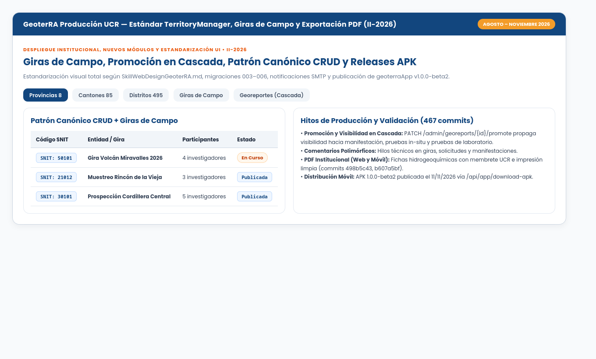

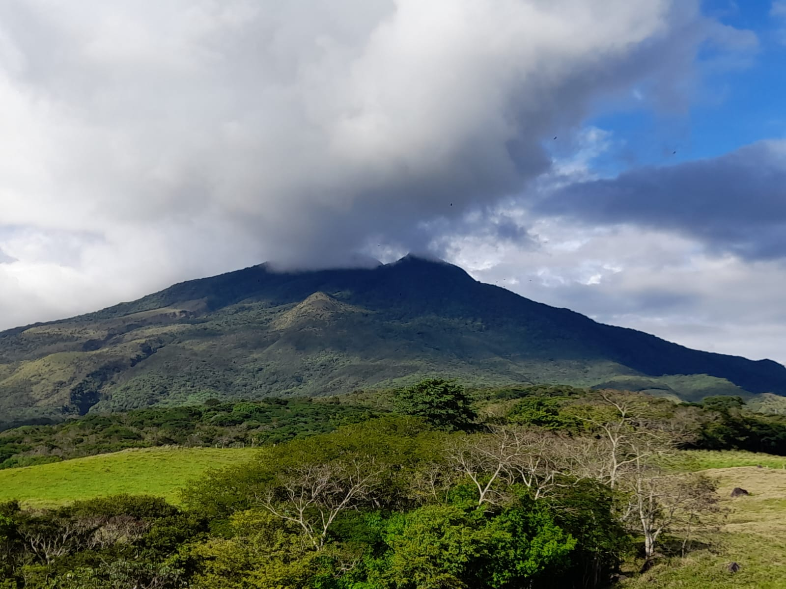

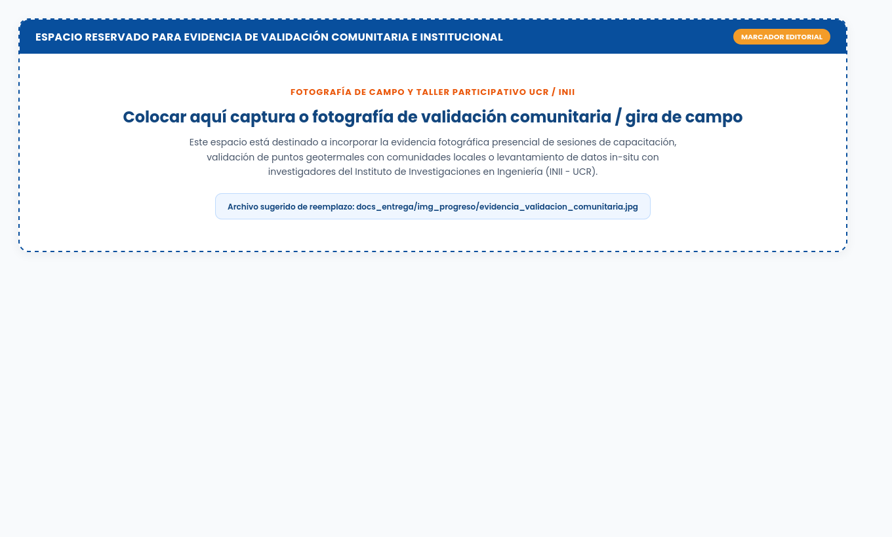

> **Nota editorial sobre validación comunitaria e institucional (II-2026):** Se incluye fotografía de referencia de trabajo de campo del repositorio (`trabajo_campo_ucr.jpeg`). En el marcador inferior (`img_progreso/evidencia_validacion_comunitaria_nota.png`) puede incorporarse la fotografía oficial de cierre o taller de validación comunitaria e institucional con actores locales e investigadores del INII-UCR.

---

## 3. Evolución de la Arquitectura y Stack Tecnológico

### 3.1 Comparativa Técnica: Inicio (Abril 2024) vs. Producción Actual (Noviembre 2026)

| Dimensión Técnica | Arquitectura Inicial (Abril 2024) | Arquitectura Actual en Producción (Noviembre 2026) |
| :--- | :--- | :--- |
| **Backend API** | Scripts PHP procedurales dispersos (`login.inc.php`, `request.inc.php`, `dbhandler.inc.php`) con SQL directo | Arquitectura Limpia en Capas (PHP >= 8.1 / 8.5): `SimpleRouter`, **14 Controllers**, **17 Services**, **15 Repositories**, **28 DTOs**, `GlobalErrorHandler` |
| **Identificadores de BD** | Llaves enteras autoincrementales (`AUTO_INCREMENT`) expuestas | Identificadores **ULID (`CHAR(26)`)** generados con `symfony/uid`, no predecibles y ordenables cronológicamente |
| **Base de Datos y Migraciones** | Esquema básico inicial sin versionamiento formal | **MariaDB** (`GeoterRA_schema.sql`) con **19 tablas + 1 vista SQL**, **6 migraciones idempotentes (`001`–`006`)**, catálogos **SNIT** (588 registros) y trigger anti-reuso |
| **Autenticación y Seguridad** | Sesiones PHP básicas en servidor (`$_SESSION`) | Esquema dual validado por `X-API-Key`: **Cookies HTTP-only** (Web) y **Bearer + Refresh Token Rotation con `family_id`** (Mobile), OTP SMTP y **5 roles RBAC** |
| **Frontend Web** | Páginas estáticas HTML/CSS/JS y PHP con jQuery/DOM manual | **SPA React 18.3 + Vite 6.3 + Tailwind CSS 4.1 + Ant Design 5.27**, `react-router-dom 7`, `Leaflet 1.9` y `Recharts 3.4` |
| **Aplicación Móvil** | Prototipo Android nativo básico en Kotlin con Fragments y `FusedLocation` | **Kotlin Multiplatform (KMP 2.2.21) + Compose Multiplatform 1.7.1** (`Android` + `iOS`), **Koin 4.1**, **Ktor 3.0**, **Voyager 1.1**, `MapLibre`, cámara EXIF y **PDF nativo** |
| **Analítica Geocientífica** | Marcadores geográficos simples sin procesamiento químico | **Diagrama de Piper** (facies ternarias), **Diagrama de Lindal**, conversión **CRTM05–WGS84** (`proj4php`), análisis *in-situ* y 14 parámetros de laboratorio |
| **Calidad y Documentación** | Pruebas manuales ad-hoc sin cobertura ni documentación formal | **44 suites PHPUnit 11 + Mockery + ParaTest**, Playwright configurado en web, portal **Docusaurus**, referencia `Doc API GeoterRA.md` y colección Postman |
| **Despliegue e Infraestructura** | Subida manual de archivos y merges directos a `main` | Orquestación **GitHub Actions CI/CD** multirrama (`API`, `web`, `mobile` -> `develop` -> `main`), build automatizado Vite y scripts `SERVER.migrate.sh` / `DOCKER.migrate.sh` |

### 3.2 Diagrama de Arquitectura Integral en Producción (Noviembre 2026)

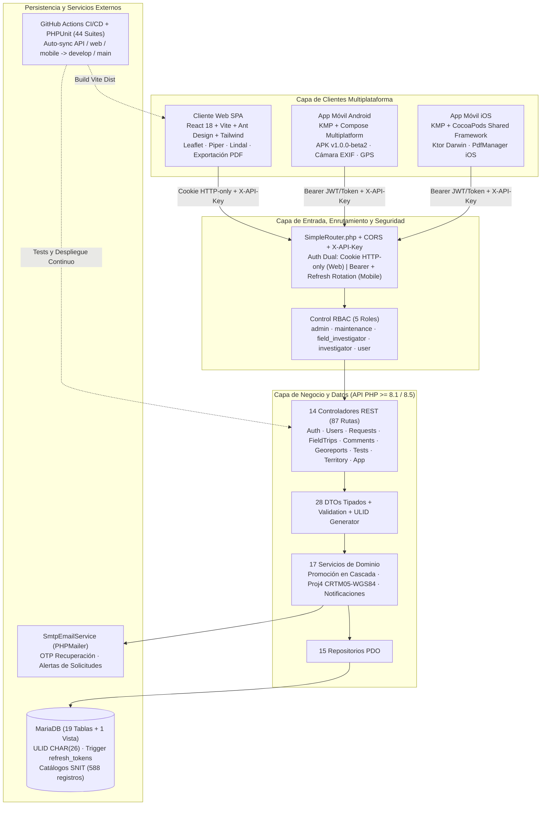

### 3.3 Línea de Tiempo Evolutiva por Semestres Académicos (2024–2026)

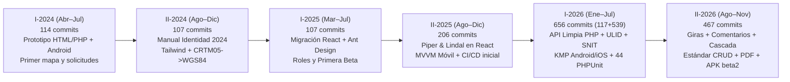

### 3.4 Flujo Transaccional de Curaduría Científica y Visibilidad en Cascada

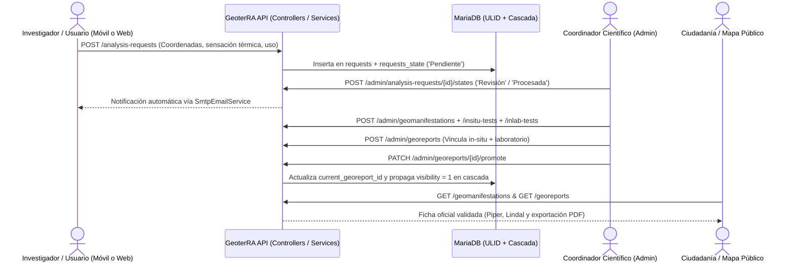

---

## 4. Estado Actual del Producto y Próximos Pasos

### 4.1 Capacidades Activas en Producción (Noviembre 2026)

A la fecha de corte del presente informe (**noviembre de 2026**), el ecosistema **GeoterRA** opera integralmente con los siguientes módulos validados en sus tres plataformas:

1. **Portal Público e Interactivo de Divulgación Geotermal (Web y Móvil):**
   - Visor cartográfico nacional sobre **Leaflet** (Web) y **MapLibre** (Móvil) con filtrado territorial multinivel (**8 provincias, 85 cantones, 495 distritos SNIT**) y capas térmicas.
   - Paneles de detalle científico (`PointDetails.jsx`, `GeomanifestationScreen.kt`) con representación automática de **Diagramas de Piper** (caracterización hidrogeoquímica mediante 14 parámetros de laboratorio: pH, conductividad, Cl, Ca, HCO3, SO4, Fe, Si, B, Li, F, Na, K, Mg) y **Diagramas de Lindal** (aprovechamiento térmico directo).
   - **Exportación Oficial en PDF:** Generación de fichas técnicas imprimibles con membrete UCR desde navegador y descarga/compartición de PDF en dispositivos móviles.

2. **Gestión Operativa y Gobernanza por Roles (RBAC de 5 Perfiles):**
   - **`user`:** Creación, seguimiento de historial de estados y edición de sus propias solicitudes de análisis geotermal mientras permanezcan en estado `Pendiente`.
   - **`investigator` y `field_investigator`:** Gestión de geomanifestaciones, registro de pruebas *in-situ* y laboratorio, planificación y participación en **Giras de Campo** (`FieldTripsManager`), y trazabilidad colaborativa mediante **Comentarios Polimórficos**.
   - **`admin` (Coordinador Científico):** Curaduría total de solicitudes, promoción de georeportes a vigentes y control de **visibilidad pública en cascada**.
   - **`maintenance` (DevOps / Sistemas):** Dashboard de salud del sistema, gestión de usuarios y asignación de roles, visor de tablas de base de datos (`DatabaseViewer.jsx`) e inspección de logs de servidor (`SystemLogs.jsx`).

3. **Distribución Móvil y Operación Institucional:**
   - Distribución directa de la aplicación Android **`geoterraApp` v1.0.0-beta2** mediante endpoints públicos de la API institucional (`/api/app/download-apk`), junto con base de código iOS compilable vía CocoaPods.
   - Soporte de notificaciones institucionales por correo electrónico (OTP de recuperación, estados de solicitudes y cambios de perfil) y sincronización continua automatizada mediante GitHub Actions.

### 4.2 Evidencia de Campo de Recursos Geotérmicos Catalogados

Los activos visuales integrados en la aplicación móvil reflejan las tipologías de manifestaciones geotermales documentadas y catalogadas dentro del ecosistema GeoterRA:

| Manifestación Fumarólica | Naciente Termal (Hot Spring) | Inspección Territorial con Dron |
| :---: | :---: | :---: |
|  |  | 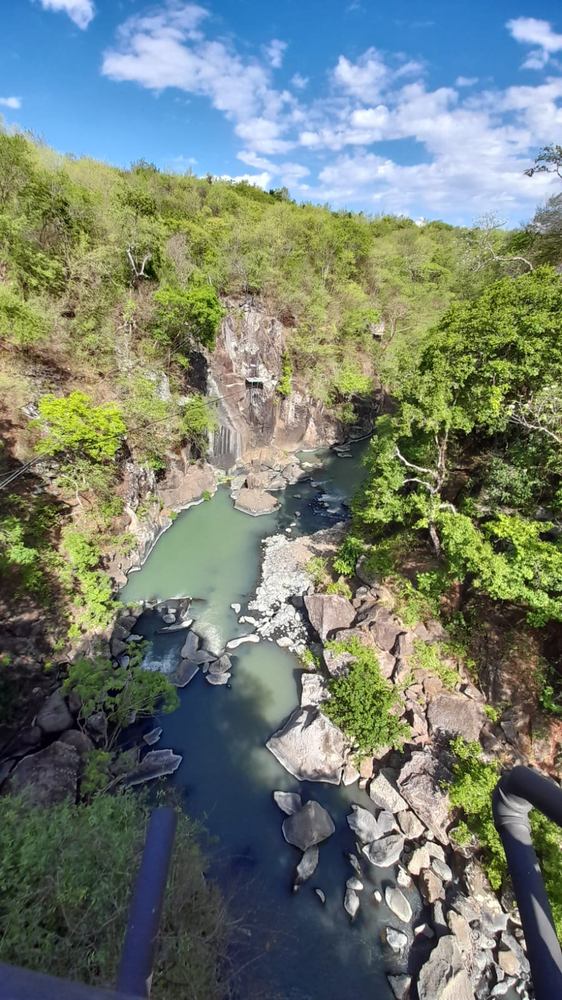 |

### 4.3 Próximos Pasos y Hoja de Ruta Post-Despliegue (2027)

Para dar continuidad al ciclo de maduración tecnológica y académica en la Universidad de Costa Rica, se recomiendan cuatro líneas prioritarias de evolución:

1. **Sincronización Offline-First en Campo:** Incorporar persistencia local en SQLDelight o Room KMP dentro de `Mobile/GeoterRa` para permitir la captura completa de pruebas *in-situ*, fotografías con metadatos EXIF y formularios de giras de campo en zonas volcánicas sin cobertura celular, con sincronización diferida automática al recuperar conectividad.
2. **Publicación Formal en Tiendas Oficiales (Google Play Store y Apple App Store):** Completar los procesos de firma institucional UCR/INII y revisión en tiendas para sustituir gradualmente la distribución directa de APK por actualizaciones gestionadas en tienda, manteniendo el endpoint `/api/app/version` para verificación de compatibilidad.
3. **Expansión de Pruebas E2E Automatizadas y Telemetría:** Ampliar la suite existente de **Playwright** en `website/tests/` para cubrir flujos completos de curaduría científica y consolidar métricas de monitoreo en tiempo real en el panel de mantenimiento.
4. **Interoperabilidad Abierta y Ciencia Ciudadana (API Pública / GeoJSON):** Exponer endpoints de descarga abierta en formatos estándar geocientíficos (**GeoJSON / CSV / OGC**) para facilitar el consumo directo de los datos validados por parte de investigadores nacionales, instituciones del sector energético costarricense (ICE, MINAE, OVSICORI) y proyectos académicos interdisciplinarios.

---

**Elaborado para:** Dirección del Proyecto GeoterRA — Instituto de Investigaciones en Ingeniería (INII), Universidad de Costa Rica.  
**Auditoría basada en datos verificables del repositorio `GeoterRA_DEV/` (1,657 commits · 06/04/2024 – 12/11/2026).**
